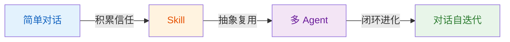
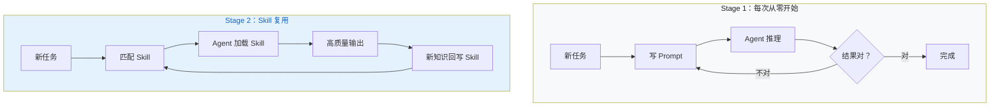
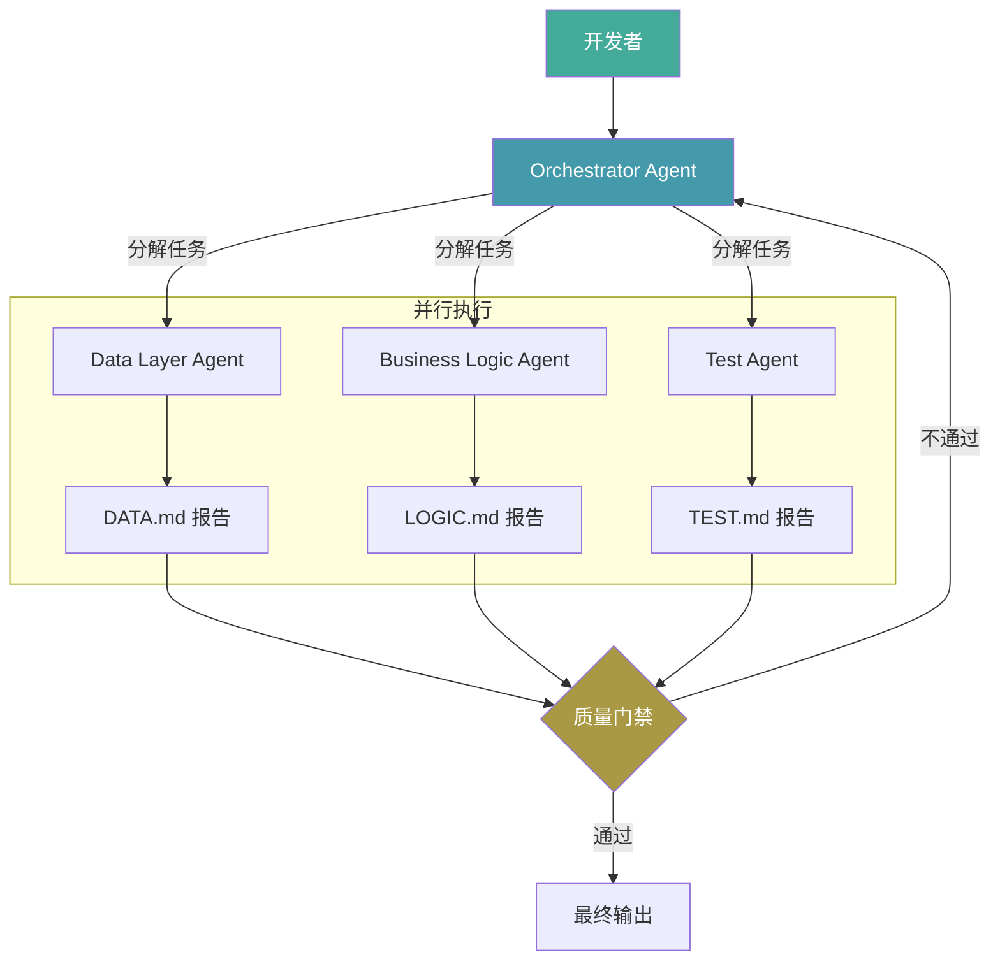
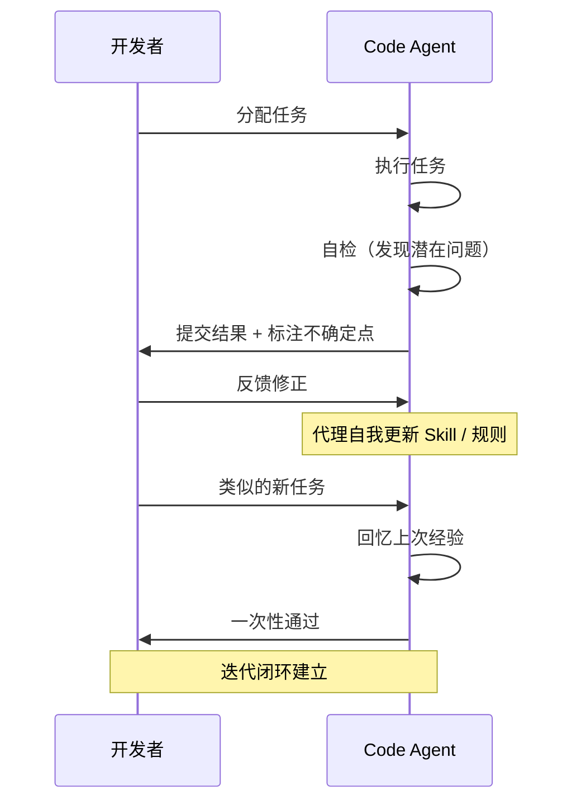
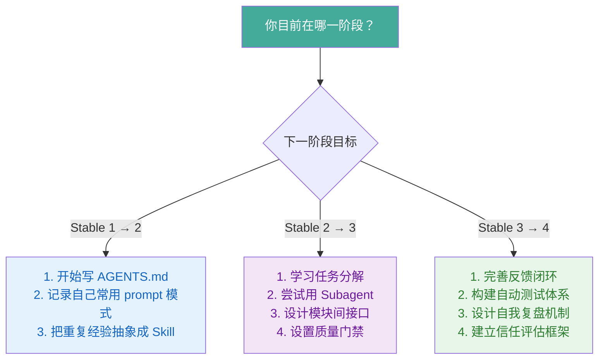

> **核心观点**：Code Agent 的能力在快速进化，但多数开发者对它的使用仍停留在"高级自动补全"。真正拉开差距的，是开发者能否随着 Agent 的进化，同步升级自己的使用能力。本文提出一个四阶段模型——简单对话、Skill、多 Agent、对话自迭代——帮助定位你当前所处的阶段，以及下一阶段需要什么能力。

---

## 一、为什么需要这个模型

2026 年的 Code Agent 在 SWE-bench Verified 上的最高分已经突破 95%（Claude Fable 5），能自主修复 bug、升级依赖、开 PR。**但 SWE-bench Verified 有数据污染问题**——部分任务泄露到了训练集中；在防污染的 SWE-bench Pro 上，最高分约 77%。这意味着 Agent 的真实工程能力仍在快速提升，但不如表面数字那么夸张。这只是 Agent 的能力上限，不是你的实际产出。

同一个工具在不同人手里，产出可以差一个数量级。区别不在于你会不会用，而在于你对 Agent 的**利用模式**。

我把自己和团队使用 Code Agent 的经验总结为四个阶段。每个阶段代表一种质变——不只是 Agent 更强了，而是你作为一个开发者，使用 Agent 的方式发生了根本性的变化。



---

## 二、四个阶段详解

### Stage 1：简单对话

这是大多数人所在的阶段，也是 Agent 能力的起点。开发者通过自然语言与 Agent 对话，Agent 根据当前对话上下文生成代码。

**你的工作方式**：

- 写一段 prompt，等 Agent 回复，复制代码，手动跑测试
- 如果一个任务比较复杂，手动拆成几步，一步步问
- 每次新会话都要重新描述上下文
- 遇到 Agent 写错，手动修改，或者重新 prompt

**你的核心能力**：

| 能力 | 说明 |
|------|------|
| **Prompt 表达** | 能把模糊的需求转化为清晰的指令 |
| **上下文管理** | 知道给什么、不给什么，避免信息过载 |
| **判断力** | 能快速判断 Agent 输出是否靠谱，不盲信 |
| **纠错** | 发现错误后能精确指出问题位置和方向 |

**技术支撑**：AGENTS.md / 项目级规则文件

这是你能用最短时间起步的阶段，但瓶颈也很明显——**每次会话都是新的，没有积累，没有复用**。你的经验存在于你的脑子里，Agent 每次都是从零开始。

**阶段性标志**：你能用 Agent 独立完成一个中小型功能，不需要来回返工超过 3 次。

#### 实践技巧

**1. Prompt 三段式结构**

不要写大段描述，用固定模板组织 prompt：

```
你是一个 [角色]。
目标：[具体交付物]。
约束：[不可协商的条件：代码风格、测试要求、禁止新增依赖等]。
```

研究表明 LLM 的推理质量随输入长度增加而持续衰减——这不是某个特定长度的"断崖"，而是一条平滑下降曲线，且不同模型差异显著。一个实用的经验是保持 prompt 在 **150-300 词**。先写最简版本跑一次，只在需要修正特定 gap 时才加内容。

**2. XML 标签优于 Markdown 标题**

Claude Sonnet 4 / Opus 4 对字面指令的遵循度很高，用 XML 标签比 Markdown 更精确：

```xml
<context>认证中间件在 src/middleware/auth.ts</context>
<task>为登录端点添加限流</task>
<constraints>使用现有的 RateLimiter 类，不新增依赖</constraints>
```

**3. 正向表达优于否定指令**

"只使用真实数据"的效果远好于"不要使用假数据"。否定指令会迫使模型先处理被禁止的概念（粉红大象效应），增加出错概率。

**4. Few-Shot 示例：多样性 > 完美度**

给 3-5 个不同场景的示例，比给一个完美但单一的示例更重要。Min et al. (2022) 发现示例的**分布空间**比标签是否正确更关键。

**5. 新任务开新会话**

Agent 对话存在"上下文腐烂"（Context Rot）现象——性能随输入长度增加而持续下降，且从对话早期就已开始。一个小技巧：**新任务 = 新会话**。用 `clear` 重启而不是在同一个对话里继续。

**6. 典型反模式**

| 反模式 | 正确做法 |
|--------|---------|
| 写一整段"帮我实现一个博客系统" | 拆成需求 → 设计 → 数据层 → API → 前端 分步推进 |
| 把整个项目代码扔进 prompt | 只贴相关文件，用 AGENTS.md 提供全局上下文 |
| Agent 出错后说"重做" | 精确指出哪行代码有问题、预期的行为是什么 |
| 同一个会话里连续做 3 个不同功能 | 每个功能单独开一个会话 |

---

### Stage 2：Skill

Skill 阶段的核心变化是：**你不只在对话，你在构建可复用的能力包**。

Skill 是把你做过的有效实践固化下来，让 Agent 不再每次都从零推理。不论是 AGENTS.md、自定义规则，还是 MCP Server 集成，都是在给 Agent 装备"经验"。



**你的工作方式**：

- 遇到好用的 prompt 模式，不重复写，而是存成 Skill
- 对常见的任务类型，编写专门的领域规则
- Agent 处理完成之后，把经验回写到 Skill 库
- 多个 Skill 可以组合，应对更复杂的场景

**你的核心能力**：

| 能力 | 说明 |
|------|------|
| **抽象能力** | 能从具体的 prompt 中提炼出可复用的模式 |
| **知识管理** | 把项目特有的领域知识、编码规范、约束写成规则文件 |
| **工具集成** | 会写 MCP Server，让 Agent 直接操作外部系统 |
| **质量意识** | 能判断 Skill 的质量，哪些值得固化，哪些应该废弃 |

**技术支撑**：AGENTS.md / MCP Server / Skills 插件市场 / 项目级规则

这个阶段是开发者能力真正开始分化的地方。能写好 Skill 的人，相当于给自己的 Agent 装上了"行业经验包"，效率和准确率远超只会写 prompt 的阶段。

**阶段性标志**：你有一组自己维护的 Skill，新任务大多可以用已有 Skill 组合完成，不需要从头写 prompt。

#### 实践技巧

**1. AGENTS.md 保持聚焦，控制在 200-300 行**

AGENTS.md 已被 Linux Foundation 的 Agentic AI Foundation 采纳为标准，6 万 + 仓库在使用。Claude Code、Codex CLI、Cursor、Continue.dev、Aider 都支持。

**该放的：**

```markdown
## Commands
- Build: `npm run build`
- Test single: `npm test -- path/to/test.ts`
- Lint: `npm run lint`
- Type check: `npx tsc --noEmit`

## Stack
- Framework: Next.js 15 (App Router)
- Language: TypeScript 5.7 (strict mode)
- Database: PostgreSQL 16 with Drizzle ORM

## Conventions
- Named exports only
- API routes return { data, error } shape
```

**不该放的：** 代码风格规则（交给 ESLint/Prettier）、显而易见的建议、完整的 API 文档（放链接即可）、一次性任务记录。

Codex CLI 在有 `AGENTS.override.md` 时会和 `AGENTS.md` 合并读取。override 文件可以 gitignore，放个人偏好和本地路径。这是团队共享规则和本地个性化配置并行存在的关键机制。

**2. Skill 目录用渐进式加载结构**

```
.claude/skills/db-migration/
├── SKILL.md          ← 核心指令
├── references/       ← 只在需要时加载的参考文档
├── scripts/          ← 辅助脚本
└── examples/         ← 按需获取的示例
```

**3. 写一个"坑记录"（Gotchas）段落**

Skill 里最有价值的不是 Agent 做对了什么，而是 Agent 曾经做错过什么。每次 Agent 踩坑后，把错误模式和修正方案写进 Skill。积累 3-5 条后，准确率会有明显提升。

```
## Gotchas
- Drizzle 的 `eq()` 在 PostgreSQL 下大小写敏感，需要用 `ilike()` 做模糊匹配
- 这个项目的 session 管理在 Redis 里，不要在代码里直接操作 cookie
```

**4. Skill 的 description 字段写给模型看**

```yaml
# 对用户友好，但对模型无用
description: "数据库迁移工具，包含生成和回滚功能"

# 对模型友好——告诉模型什么时候该触发
description: "当用户提到 schema 变更、数据库迁移、alter table、或者模型定义变化时使用"
```

**5. MCP 集成：结构化优于自然语言**

MCP 提供类型安全的工具接口，团队实践显示 MCP + 沙箱可**减少 84% 的权限提示**。用 `.mcp.json` 定义：

```json
{
  "mcpServers": {
    "database": {
      "command": "mcp-database-server",
      "args": ["--connection-string", "postgresql://localhost/mydb"]
    }
  }
}
```

**6. 技巧组合示例：多层规则叠加**

```
~/.claude/CLAUDE.md              ← 个人全局规则
AGENTS.md                        ← 项目根规则
src/frontend/AGENTS.md           ← 前端子模块覆盖
src/backend/AGENTS.md            ← 后端子模块覆盖
```

最近的文件优先级最高。OpenAI 自己的仓库用了 88 个嵌套的 AGENTS.md 文件。

**7. 典型反模式**

| 反模式 | 正确做法 |
|--------|---------|
| AGENTS.md 写了 1000 行，每个细节都规定死了 | 保持 200-300 行，核心命令 + 约定即可，细节交给工具链 |
| Skill 堆了 20 个，但都是"如何写 React 组件"这种泛型知识 | Skill 应该是领域特定的，泛型知识交给模型本身 |
| 写了一个 Skill 就再也不更新 | 每次使用后反思：这次有没有踩新坑？Skill 还覆盖了所有场景吗？ |
| 试图用 AGENTS.md 替代测试 | AGENTS.md 表达意图，测试验证实现——两者互补，不可替代 |

---

### Stage 3：多 Agent

多 Agent 阶段的核心变化是：**你从一个"对话者"变成了"协调者"**。

你不再和单 Agent 对话，而是布置任务给多个 Agent，让它们并行工作、各司其职。你的工作从"写 prompt"变成了"写任务说明书"。



**你的工作方式**：

- 面对一个大任务，先分解成多个小任务，分配给不同的 Agent
- 关注模块间的接口契约，而不是具体实现
- 用报告机制让 Agent 之间互相通信，而不是手动转述
- 设置质量门禁，不达到标准就退回重做

**你的核心能力**：

| 能力 | 说明 |
|------|------|
| **任务分解** | 能把大问题拆成可独立执行的小问题 |
| **接口设计** | 定义好 Agent 之间的输入输出契约 |
| **质量门禁** | 设计检查点，确保每个 Agent 的输出达标 |
| **并行调度** | 识别哪些任务可并行、哪些有依赖关系 |
| **结果集成** | 把多个 Agent 的输出整合成一个 coherent 的结果 |

**技术支撑**：Subagent / Agent Teams / 层级编排 / 文件锁 / 依赖追踪

这个阶段需要的核心转变是：**从关心"怎么实现"到关心"怎么分配"**。你的注意力从代码层面上升到架构层面——你在组织一个开发团队，而不是在和一个助手对话。

**阶段性标志**：你能同时运行多个 Agent 处理不同模块，它们很少互相冲突，输出可以顺利集成。

#### 实践技巧

**1. 先判断是否值得多 Agent**

不是所有任务都值得多 Agent。三个单 Agent 的墙：
- **上下文过载**：一个 Agent 装不下整个大型代码库
- **缺乏专精**：一个 Agent 同时处理数据层、API、前端、测试，每部分都平庸
- **无法协调**：没有共享任务列表，手动传递信息

只有任务同时触达这三面墙时，才值得引入多 Agent。

**2. Subagent 模式：最快的入门路径**

Parent Orchestrator 用 Task 工具派生子 Agent，每个有独立上下文窗口。以"用 Express + SQLite 构建书签管理器"为例：

```
Parent 分解任务：
  ├── Subagent 1: 数据层 (db.js, schema, CRUD) → 产出 DATA.md
  ├── Subagent 2: 验证层 (validation.js) → 产出 LOGIC.md
  └── Subagent 3: API 路由 (读取 DATA.md + LOGIC.md) → 构建 server.js
```

前两个独立并行，第三个依赖前面两份报告。Parent 人工管理依赖图。总 token 消耗约 220K，与单 Agent 基本持平，但获得了并行加速和上下文隔离。

**3. Agent Teams 模式：升级后的方案**

Agent Teams 在 Subagent 基础上增加了三个原语：

- **共享任务列表**：每个任务有状态（pending / in_progress / completed / blocked）
- **Peer-to-Peer 消息**：Agent 之间可以直接通信，不用经过 Orchestrator
- **文件锁**：防止两个 Agent 同时写入同一个文件

启用：`export CLAUDE_CODE_EXPERIMENTAL_AGENT_TEAMS=1`

**4. 三个关键质量门禁**

- **循环门禁**：每个 Agent 设置 `MAX_ITERATIONS=8`。每次重试前强制反思："什么失败了？这次改什么？我在重复同样的方法吗？"
- **专用 Reviewer**：设置一个只读的 Agent，拥有 lint / 测试 / 安全扫描工具。自动在任务完成后触发。Orchestrator 只看审核通过的代码。
- **计划审批**：对高风险任务，要求 Agent 先写计划，Orchestrator 审核后再执行。

**5. 团队规模保持 3-5 个**

3-5 个是甜区。Token 成本随 Agent 数量线性增长。三个专注的 Agent 始终优于五个意识涣散的 Agent。更多未必更好。

**6. 层级编排（Teams of Teams）**

不要从 Orchestrator 直接派生 6 个 Subagent——这会碎片化 Orchestrator 的上下文。改成分两层：

```
Orchestrator（只和 2 个 Feature Lead 通信）
  ├── Feature Lead A（负责搜索功能）
  │   ├── 数据子 Agent
  │   ├── 逻辑子 Agent
  │   └── API 子 Agent
  └── Feature Lead B（负责用户管理）
      ├── 数据子 Agent
      └── API 子 Agent
```

这模拟了真实工程组织的层级结构。

**7. 文件冲突预防**

| 策略 | 做法 |
|------|------|
| **隔离优先** | 每个 Agent 在自己的分支 / 沙箱工作，冲突在 PR 评审时暴露 |
| **Git Worktrees** | 每个 Agent 独立的工作目录，运行时完全无冲突 |
| **文件边界显式声明** | 定义每个 Agent 能修改的模块/文件范围 |
| **文件锁** | Agent Teams 内置的文件锁机制，阻止并发写入同一文件 |

**8. 典型反模式**

| 反模式 | 正确做法 |
|--------|---------|
| 一个简单的 CRUD 也要 4 个 Agent | 一个 Agent 30 分钟搞定的事，多 Agent 的光协调就花了 20 分钟 |
| 让所有 Agent 看整个代码库 | 给每个 Agent 只分配它需要的文件范围 |
| 没有依赖图，直接派发 | 先画依赖图：哪些任务可并行、哪些必须串行 |
| Reviewer Agent 和 Worker Agent 同模型 | Reviewer 应该用不同模型或不同 prompt，避免"闭眼自我审查" |
| 所有 Agent 共享同一个 MCP Server | 根据职责分配不同工具：数据库 Agent 才有 DB 权限 |

---

### Stage 4：对话自迭代

对话自迭代是最容易被忽视的阶段。这个阶段的核心变化是：**Agent 不只在帮你写代码，它还在自我改进**。

这意味着 Agent 会从错误中学习，会回顾自己的输出，会主动发现自己的不足并修正。你不再需要每一次都指出"这里不对"，Agent 自己能识别出模式性的问题。



**你的工作方式**：

- Agent 在完成一个任务后会跑测试、分析失败、自动修正
- Agent 会标注自己不确定的地方，主动寻求确认，而不是猜测
- 每次迭代的知识积累回写到规则库，下个任务自动受益
- Agent 能识别出"这次的情况和上次一样"，自动应用学到的经验

**你的核心能力**：

| 能力 | 说明 |
|------|------|
| **反馈质量** | 你的反馈越精确，Agent 迭代越快 |
| **闭环设计** | 设计从执行→验证→反馈→改进的完整回路 |
| **信任校准** | 知道什么时候信任 Agent，什么时候人工介入 |
| **边界感知** | 知道 Agent 当前能力的边界，不部署超出能力的任务 |
| **复盘能力** | 能回顾 Agent 的失败模式，从根本上改进规则 |

**技术支撑**：自动测试 / CI 集成 / 经验回写 / 质量门禁 / 记忆系统

这个阶段是投入产出比最高的——你的每次反馈都在为未来投资。但这也是最难做到的，因为它要求开发者对自己和 Agent 的行为都有清晰的认识。

**阶段性标志**：同样的错误不犯第二次，Agent 能在无人监督的情况下完成≥80%的中低复杂度任务。

#### 实践技巧

**1. 自迭代的内核：Generate → Critique → Revise 循环**

```
生成初稿
  → 批评审查（应用检查清单、跑测试、查来源）
    → 通过？交付
    → 失败？逐一修正标记的问题，继续循环
```

两个安全阀：**迭代上限**（默认为 3，超限停机）和**提前退出**（没有可操作的改进点时停止）。

**2. 一个重要的认知：模型无法自检**

Huang et al. (2023) 在《LLMs Cannot Self-Correct Reasoning Yet》中证明：同一个模型既写又审，**准确率反而可能下降**——因为它用自己的盲点来验证自己的输出。这就是"一致性陷阱"（Coherence Trap）。

**核心原则：永远不要让写代码的模型评价自己的代码。**

**3. 按强度排序的四种检验信号**

| 信号 | 强度 | 例子 | 说明 |
|------|------|------|------|
| **执行** | ⭐⭐⭐⭐⭐ | 跑测试、编译、执行 SQL | 最强的信号，无可争议 |
| **工具验证** | ⭐⭐⭐⭐ | Lint / 类型检查 / 静态分析 | 规则化，可自动化 |
| **检索** | ⭐⭐⭐ | 重新查询来源验证事实 | 依赖外部源的质量 |
| **LLM 评判** | ⭐⭐ | 用不同的模型做审查者 | 比自检好，但仍需人工兜底 |

**反射机制（Reflexion）**（Shinn et al.）是自迭代的经典实现，包含三个组件：

- **Actor**：生成文本 / 行动（使用 CoT 或 ReAct）
- **Evaluator**：评分输出（二元通过/失败、启发式规则、或 LLM 评分）
- **Self-Reflection Model**：生成自然语言解释——什么失败了、怎么修→存入**场景记忆**→影响后续尝试

结果：GPT-4 在 HumanEval 上从 80% 提升到 91% pass@1。学习发生在同一会话内，无需微调。

**4. 用外部信号驱动迭代**

在 prompt 末尾嵌入检验步骤：

```markdown
Review your solution against these criteria:
1. Run `npm test` — does it pass? Fix any failures.
2. Run `npx tsc --noEmit` — any type errors?
3. Run `npm run lint` — any rule violations?
Report what you found and what you changed.
```

**外部信号 + 反射机制两者结合的效果远超任意单一策略。** 这是 Reflexion 框架的核心经验：没有外部验证的自我反思是无效的。

**5. 迭代纪律**

- 大多数收益在 **第 1-2 次迭代** 中获取。设置为 3-4 次上限。
- 达到上限还没收敛时，**回退到最佳版本**，而不是最后一个版本。
- 追踪每次修订解决的问题："第 2 版 → 定价一致了，代码编译通过，第 42 行已修正。"

**6. 搭建 /go 一键工作流**

创建一个 Slash 命令，执行完整的端到端工作流：

1. 整体端到端测试（bash / browser）
2. 自动简化清理（`/simplify`）
3. 开 PR

完成后你可以直接走开，回来就看到已验证、已合并的代码。

**7. 渐进式实施路线**

不要一开始就追求完美的自迭代，分步来：

```
Step 1: 单次输出 → prompt 末尾加 "审查你的输出，找 bug 和安全问题"
Step 2: 加执行 → 把 npm test 加入审查标准
Step 3: 加迭代 → 循环直到测试通过或达上限
Step 4: 加独立审查者 → 用不同的模型做批评
Step 5: 加持久记忆 → 把经验写到 .claude/rules/ 或场景记忆
```

**8. 典型反模式**

| 反模式 | 正确做法 |
|--------|---------|
| 相信 Agent 说"我觉得没问题" | 让测试结果说话，Agent 的自我评估不可靠 |
| 迭代了 10 次还在循环 | 设 3-4 次上限，超过就回退到最佳版本 |
| Agent 失败了就复制到新会话重来 | 先分析失败模式，修改规则/Skill，再重新尝试 |
| 只在出错时才反馈 | 即使 Agent 做对了，也可以把成功模式记下来 |
| 每次都手工跑测试 | 把测试嵌入 Agent 工作流，让它自己跑自己修 |

---

## 三、四个阶段的本质对比

| 维度 | 简单对话 | Skill | 多 Agent | 对话自迭代 |
|------|---------|-------|---------|-----------|
| **你的角色** | 对话者 | 知识工程师 | 协调者 | 系统设计师 |
| **核心能力** | Prompt 表达 | 抽象复用 | 任务分解 | 闭环设计 |
| **Agent 视角** | 一个助手 | 有经验的助手 | 一个团队 | 自进化的团队 |
| **产出确定性** | 看运气 | 较稳定 | 可预测 | 持续提升 |
| **复用性** | 几乎为零 | Skill 可复用 | 工作流可复用 | 经验自动累积 |
| **可扩展性** | 单人单任务 | 单人单任务 | 多人多任务 | 规模可复制 |

---

## 四、如何判断自己在哪个阶段

问自己几个问题：

1. 你每次用 Agent 做相似的任务，是不是都要重新写一遍 prompt？
   - 是 → 还在 Stage 1
   - 否 → 进入 Stage 2

2. 你有一个自己的 Skill/规则库吗？别人可以拿去直接用吗？
   - 否 → Stage 1 ~ 2
   - 是 → Stage 2+

3. 你同时运行过两个以上的 Agent 做不同的任务吗？
   - 否 → Stage 2-
   - 是 → Stage 3

4. Agent 很少犯你已经纠正过的错误吗？
   - 否 → Stage 3-
   - 是 → Stage 4

---

## 五、一些个人感受

写这篇文章时我想起了一个观察：**AGENTS.md 在 GitHub 上已经被 6 万多个仓库使用，但大多数只是随便写了几行简介，真正把它当成"宪法"来维护的项目极少。**

这其实也映射了这四个阶段的分布——大多数项目停留在 Stage 1，少部分到了 Stage 2，进入 Stage 3 和 4 的凤毛麟角。

但我也觉得这不一定是问题。不是所有项目都需要进入 Stage 4。如果一个项目就是你一个人维护的小工具，Stage 2 就够了。只有当你管理的项目复杂度、团队规模、迭代频率达到一定程度，Stage 3 和 4 的优势才会显现。

关键是**知道自己在这个模型的什么位置，以及现在的位置是否匹配你的需求**。

---

## 六、下一步：如果你要前进



各阶段建议关注的具体实践：

| 目标阶段 | 第一个行动 | 一个月目标 | 参考资源 |
|---------|----------|----------|---------|
| 1 → 2 | 写你的第一个 AGENTS.md，放项目命令和约定 | 有 3-5 个可复用的 Skill | [Agentic AI Foundation / AGENTS.md](https://github.com/agentic-ai-foundation) |
| 2 → 3 | 拆一个现有功能，用 Subagent 并行实现数据层和 API 层 | 能稳定运行 3 个 Agent 并行不冲突 | Claude Code Agent Teams 或 Cursor Cloud Agents |
| 3 → 4 | 给每个任务模板加上"自检清单"，让 Agent 跑测试再提交 | 同类错误降低 50% 以上 | Reflexion (Shinn et al.) 论文 + CI 集成 |

#### 各阶段自检清单

```markdown
## Stage 1 ✓  Checklist
- [ ] 我能用三段式结构写 prompt（角色 + 目标 + 约束）
- [ ] 我知道什么时候该开新会话而不是继续旧会话
- [ ] 我有自己的 AGENTS.md（至少包含命令和项目结构）
- [ ] 一个功能最多 3 轮对话能完成

## Stage 2 ✓  Checklist
- [ ] 我有 3 个以上自维护的 Skill
- [ ] 我的 AGENTS.md 包含 Gotchas 段落
- [ ] 新功能 80% 的代码可以用已有 Skill 组合完成
- [ ] 我至少集成了一个 MCP Server

## Stage 3 ✓  Checklist
- [ ] 我能把大任务分解成可独立执行的子任务
- [ ] 我设置了至少一个 Review Agent
- [ ] 多个 Agent 同时运行时，文件冲突每周少于 1 次
- [ ] 我碰见过 Agent 循环问题，并设置了迭代上限

## Stage 4 ✓  Checklist
- [ ] Agent 提交前会自动跑测试和 lint
- [ ] 我很少纠正同一个错误两次
- [ ] 我有一套机制让反馈自动回写到规则库
- [ ] 中低复杂度任务可以无人监督完成
```

---

## 术语表

| 术语 | 说明 |
|------|------|
| **Code Agent** | 能理解代码库、执行终端命令、跨文件编辑、自主跑测试的 AI 编程工具 |
| **SWE-bench Verified** | 衡量 AI 编程 Agent 能力的行业标准基准测试 |
| **Skill** | 可复用的知识包，包含特定领域的 prompt、规则、工具配置 |
| **MCP** | Model Context Protocol，Agent 与外部系统交互的开放标准 |
| **Subagent** | 由主 Agent 派生的子 Agent，负责执行独立子任务 |
| **质量门禁** | Quality Gate，自动化检查 Agent 输出的门槛条件 |
| **AGENTS.md** | 项目根目录的规则文件，定义 Agent 在项目中的行为规范 |
| **Context Rot** | 上下文腐烂，LLM 性能随输入长度增加而持续下降的现象 |
| **Reflexion** | 一种 Agent 自我改进框架：Actor 生成 → Evaluator 评分 → 反思写入场景记忆 → 影响后续尝试 |
| **SWE-bench Pro** | SWE-bench 的防污染版本，避免训练数据泄露问题 |

---

## 参考文献

1. Swarmia. *Five levels of AI coding agent autonomy, and why higher isn't always better*. 2026. https://www.swarmia.com/blog/five-levels-ai-agent-autonomy/
2. Addy Osmani. *The Code Agent Orchestra - what makes multi-agent coding work*. 2026. https://addyosmani.com/blog/code-agent-orchestra/
3. CodePick. *AI Coding Agents in 2026: A Practical Roadmap from Autocomplete to Cloud Teammates*. 2026. https://codepick.dev/en/guides/ai-coding-agents-2026-roadmap/
4. Codersera. *AI Coding Agents 2026: Claude Code, Cursor 3.5, Copilot, OpenCode*. 2026. https://codersera.com/blog/ai-coding-agents-complete-guide-2026/
5. Cursor. *FastRender: Cursor's Experience Generating Over 1 Million Lines of Code with AI*. 2026.
6. GitHub. *Spec Kit: Spec-Driven Development*. 2026. https://github.com/github/spec-kit
7. Huang, J. et al. *Large Language Models Cannot Self-Correct Reasoning Yet*. ICLR 2024. https://arxiv.org/abs/2310.01798
8. Shinn, N. et al. *Reflexion: Language Agents with Verbal Reinforcement Learning*. NeurIPS 2023. https://arxiv.org/abs/2303.11366
9. Min, S. et al. *Rethinking the Role of Demonstrations: What Makes In-Context Learning Work?* EMNLP 2022. https://arxiv.org/abs/2202.12837
10. Addy Osmani. *8 Levels of AI-Assisted Coding*. 2026. https://addyosmani.com/blog/code-agent-orchestra/
11. Chroma. *Context Rot: Measuring and Mitigating Performance Degradation in Long-Context LLMs*. 2025. https://www.trychroma.com/research/context-rot
12. Anthropic. *Making Claude Code more secure and autonomous with sandboxing*. 2025. https://www.anthropic.com/engineering/claude-code-sandboxing
13. llm-stats. *SWE-Bench Verified Leaderboard*. 2026. https://llm-stats.com/benchmarks/swe-bench-verified
