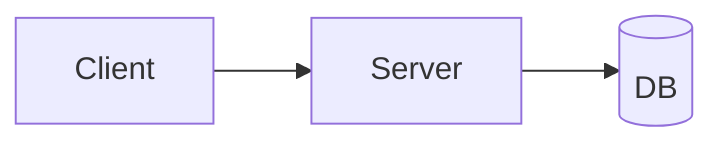
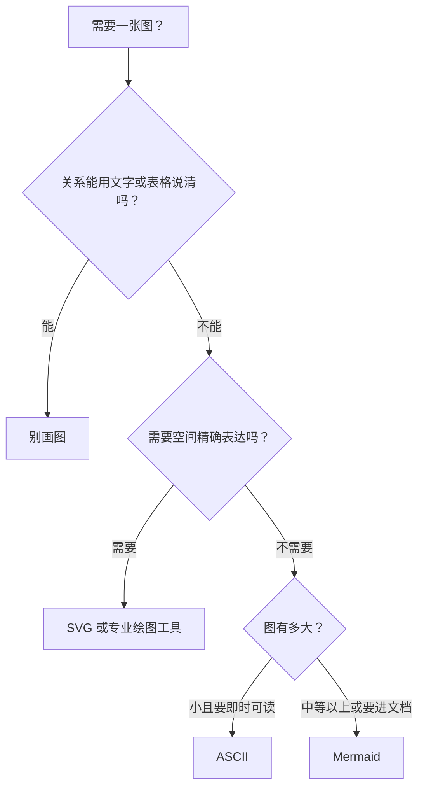

> **核心观点**：三种图表格式的差异，本质不在"谁更好看"，而在**结构、排版、验证三者的分离程度**。ASCII 把三者焊死在一起，SVG 把结构和排版都压进坐标，只有 Mermaid 做了分离。这一个差异，决定了模型写哪种图最容易出错、出错后哪种最容易发现和修复，以及"乱飞线"到底该怪谁。

---

## 一、三种格式的本质差异

我们每天都在画图，却很少追问"图是怎么被生产出来的"。ASCII、Mermaid、SVG 的差别不在外观，而在**谁负责排版**。

### 1.1 ASCII：源码即成品

ASCII 图（也叫字符画）用等宽字符在二维网格上拼出图形：

```
+----------+      +----------+      +----------+
|  Client  |----->|  Server  |----->|    DB    |
+----------+      +----------+      +----------+
```

它的特点是**源码和成品是同一个东西**。你看到的 `+`、`-`、`>` 就是文件里存的字节，中间没有图表渲染层。这也意味着**结构信息和排版信息是焊死的**——想加一个节点，就得把整张图重画一遍。

### 1.2 Mermaid：结构与排版解耦

Mermaid 是一种声明式 DSL，你只描述"谁连着谁"：



节点位置、连线路径、图形大小全部由**布局引擎**计算。这是关键：**你写的是结构，引擎算的是排版**，两者分离。

### 1.3 SVG：排版本身就是数据

SVG 用坐标描述图形：

```xml
<svg xmlns="http://www.w3.org/2000/svg" width="320" height="100">
  <rect x="20" y="40" width="100" height="40" fill="none" stroke="black"/>
  <line x1="120" y1="60" x2="200" y2="60" stroke="black"/>
  <text x="30" y="65" fill="black">Client</text>
</svg>
```

每个元素都有精确的 `x`/`y`，所以**排版信息就是源码本身**。要移动一个方框，得同时改它的坐标和所有连到它的线——和 ASCII 一样是耦合的，只是耦合的维度从字符网格换成了二维坐标。

### 1.4 一张表看清

| 维度 | ASCII | Mermaid | SVG |
|------|-------|---------|-----|
| 表达方式 | 字符网格 | 声明式 DSL | 矢量坐标 |
| 谁负责排版 | 作者 | 布局引擎 | 作者 |
| 结构与排版 | 耦合 | **解耦** | 耦合 |
| 源码可读性 | 高 | 高（结构） | 极低 |
| 渲染依赖 | 等宽字体 | 渲染器 | 浏览器 |

这个"解耦与否"，是后面所有讨论的总开关。

---

## 二、训练数据视角：数据量不等于可靠性

先抛一个反直觉的结论：**训练数据量最大的格式，往往是一次成型最不可靠的。**

按数据量大致排序：SVG > ASCII > Mermaid。但可靠性并不跟数据量走：Mermaid 在常见图型上语法正确率较高，ASCII 只在小图上可靠，SVG 则基本靠运气；而如果换一个维度看"出错后能否被发现"，Mermaid 的领先还会更大。

为什么？看三个判据：

1. **训练数据与生成目标是否同构**——数据里存的是什么，模型要生成的又是什么；
2. **约束是局部还是全局**——错误能不能被局部模式兜住；
3. **错误能否被工具捕获**——写错之后有没有信号。

### 2.1 ASCII：数据充足，却败在"数空格"

模型见过海量 ASCII 图：RFC 文档里的协议状态机、man page 里的表格、Linux 内核文档里的数据结构图，以及无数代码注释和邮件列表。这些图大多是人手精修的，质量很高。

但这里要先澄清：ASCII 图并不追求像素级对齐，**只要"看得懂"就行**——框线差一两个字符，人脑会自动补全。所以它的对齐约束是"软"的，容忍度比想象中高。

真正的麻烦是，这个容忍度有**下限**：偏移一旦累积到分不清哪个箭头连哪个框，图就废了。而现代 LLM 用 BPE 之类的子词分词器，字符会被合并进 token，模型内部并没有"第 37 列"这样稳定的位置表示，也就无法主动把偏移控制在阈值内。研究已经反复证实，LLM 在字符级任务（比如数一个单词里有几个字母、定位某个字符的位置）上系统性失败。一个主流解释指向分词——token 越长，字符的位置信息越容易被遮蔽（见 *The Strawberry Problem*、*Counting Ability*、*CharBench* 等论文）。

所以 **ASCII 的对齐缺陷是结构性的，不是数据量能补的**：小图能靠局部模式撑住，大图则会一路漂移，直到越过"看得懂"的边界。此外它还依赖等宽字体，中文字符宽度与英文不一致，中英混排时更脆弱。

### 2.2 Mermaid：数据与生成目标同构

Mermaid 的训练数据量不如 SVG，但有一个决定性的优势：**数据里存的就是结构，模型要生成的也是结构**。两者同构，没有错配。

排版根本不在训练数据里，也就不需要模型去学。模型只需要把"节点和边"这件事说对——而这恰恰是语言模型最擅长的语义建模。

但别把"同构"误读成"稳"。Mermaid 的语法其实**相当严格**：每种图型有独立文法，特殊字符要引号包裹，小写的 `end` 不能当节点名（会破坏解析），一处不合规整个图就渲染失败，而且没有部分渲染兜底。所以模型的一次通过率并没有想象中高，冷门图型和嵌套结构尤其容易翻车。

更要分清的是：**语法通过 ≠ 排版可用**。parser 只管文法，不管布局引擎把线连成什么样。一张语法合法、连线却缠成一团的图，照样不可用。Mermaid 真正的优势不是"错误少"，而是**错误响亮**——失败会暴露出来，通常还能定位到具体行。

代价则是两点：一是**版本漂移**，不同渲染器支持的语法子集不同；二是**冷门图类型数据稀疏**，比如 sankey、quadrant 这类较新的图型，模型容易写出实际不存在的语法。

### 2.3 SVG：数据海量，但分布偏斜

SVG 在训练数据里极为常见——大量网页、图标集和设计工具的导出产物都是 SVG。但这份数据**高度偏斜**：绝大多数是图标和插画，真正手写的大型架构图极少。

更麻烦的是，架构图要求**全局几何一致性**：方框在 (100, 50)，箭头必须连到 (300, 200)，这两个坐标得互相成立。自回归生成没有任何全局校验机制，模型学到的是局部 token 模式，产出的是"局部合理、全局错乱"的图。

学术界对此有明确观察：LLM 生成 SVG 时，在**结构有效性、语义准确性、视觉一致性**三方面都容易出问题（Reason-SVG, CVPR 2026）；而布局设计本身就要求精确的空间推理，这正是当前 LLM 的短板（LaySPA）。

### 2.4 对比

| 维度 | ASCII | Mermaid | SVG |
|------|-------|---------|-----|
| 数据量 | 大 | 中 | 极大 |
| 数据与生成目标 | 不同构（数据是排版成品） | **同构（都是结构）** | 不同构（数据是坐标成品） |
| 主要约束 | 列对齐（软约束） | 语法严格（局部） | 几何一致（全局） |
| 一次成型可靠性 | 小图高、大图低 | 中（语法严、易失败） | 低 |
| 错误可见性 | 低（错位静默） | **高（parser 报错）** | 低（布局错误静默） |

---

## 三、空间结构视角：解耦与耦合

### 3.1 解耦的真正价值

Mermaid 把结构和排版解耦，带来一个直接后果：**改结构不会牵动排版**。

你想在 Server 和 DB 之间加一层 Cache，在 Mermaid 里只需加一段 `B --> D[Cache] --> C`，剩下的交给引擎。而在 ASCII 或 SVG 里，你得把整张图重排一遍——而重排恰恰是模型最弱的环节。

所以解耦不是审美问题，是**把模型的职责限制在它擅长的范围内**。

### 3.2 局部模式 vs 全局约束

自回归生成是"从左到右、不可回退"的。它天然擅长**局部模式**（下一个 token 像什么），天然不擅长**全局约束**（整篇必须满足某个条件）。

- ASCII 的列对齐：软约束 → 小图容错、大图漂移
- SVG 的坐标一致：全局约束 → 会错位
- Mermaid 的语法合法：局部约束 → 不累积，且错了会被 parser 抓住

这就是为什么三种格式在模型手里表现差异这么大。

### 3.3 当布局本身携带语义：Mermaid 的"乱飞线"

但解耦也有代价。**架构图、拓扑图的布局本身就是语义的一部分**：哪一层在上面、哪些节点属于一个区域、哪条是主链路——这些信息作者心里清楚，布局引擎却不知道。

Mermaid 的布局引擎（无论 dagre 还是 ELK）是**通用图布局器**：它不知道哪些边是主线、哪些是次要依赖，所有边一视同仁。一遇到子图嵌套、环、多对多关系，它就开始拉长弧线绕路——这就是大家常说的"乱飞线"。

更难受的是，**你几乎没法微调**。Mermaid 没有直接的手段让你"把这个节点往左挪一点"，你只能通过重构图的语义（拆图、调方向、改子图结构）去间接影响布局。这时候，Mermaid 的解耦优势反而变成了劣势：模型只碰结构，但人想要的是布局。

相比之下，ASCII 的布局是作者直接写下的，语义和排版一致。所以在"布局即语义"的图上，ASCII 的潜力确实高于 Mermaid 的自动布局——**前提是模型撑得住**。

### 3.4 关于 dagre 和 ELK 的补充

"乱飞线"很大程度是 **dagre** 的锅。dagre 是 Mermaid 长期以来的默认布局引擎，对交叉边和嵌套子图的处理比较粗糙。较新的 Mermaid 已经支持 **ELK（Eclipse Layout Kernel）**，正交路由和嵌套图的表现更好；Mermaid 的开发分支已把 ELK 设为默认布局，但截至 11.17.x 稳定版，默认仍然是 dagre，ELK 需要显式启用（`layout: elk`）。

但这里有个现实问题：**各平台内置的渲染器版本往往滞后**。GitHub、GitLab、各类 Jekyll 插件用的 Mermaid 版本各不相同，通常也落后于官方最新版，更不一定启用了 ELK；Confluence 甚至没有原生支持，得装第三方宏。所以同一份 `.mmd` 源码，在你本地编辑器里可能很清爽，贴到文档平台就变成了蜘蛛网。这就是后面要说的"渲染器缝隙"。

---

## 四、直观程度视角：源码与成品之间的缝隙

### 4.1 什么叫"直观"

讨论图表时，"直观"常被当成一个模糊的褒义词。但拆开看，它其实是**源码和成品之间有没有缝隙**：

- 缝隙为零：你看到的就是存在的
- 缝隙中等：你看到的和存在的是两样东西，但可以互相对照
- 缝隙很大：你只能看到成品，源码完全不可读

### 4.2 三种格式的缝隙

**ASCII：零缝隙。** 源码即成品，人不需要任何工具就能读，也能在终端、注释、聊天窗口里直接传递。代价是表达力天花板低——节点一多就挤，空间关系几乎表达不了。

**Mermaid：中等缝隙。** 人有两个视图：源码（结构）和渲染结果（外观）。两者通常一致，但可能因为渲染器版本不同而分叉。好处是**人可以对源码做语义审查，对渲染做外观审查**，形成双重校验。

**SVG：最大缝隙。** 成品最直观——像素级精确，所见即所得；但源码完全不可读。人只能看渲染结果，无法审查"图为什么长这样"。

| 格式 | 人看到什么 | 能否审查源码 | 表达力上限 |
|------|-----------|-------------|-----------|
| ASCII | 源码即成品 | 能 | 低 |
| Mermaid | 源码 + 渲染 | 能（结构） | 中 |
| SVG | 只有像素 | 不能 | 高 |

### 4.3 完成度悖论：越好看，越容易漏审

这里有个容易被忽略的心理学效应：**完成度会诱发自动化偏差（automation bias）**——人会倾向于接受自动化系统给出的结果，即使存在矛盾信息（Skitka et al., 1999）。

SVG 渲染出来往往很精致，人扫一眼觉得"看起来对"，就容易签字放行；而 ASCII 天生带草稿感，人反而会凑近认真读。换句话说，**SVG 的"好看"在验证场景下不一定是优点，它降低了人类审查的强度**，让错误更容易溜过去。

这或许也解释了为什么在很多严谨的工程文档里，朴素的图反而比精美的图更受信任。

---

## 五、可验证性：谁在检查这张图

### 5.1 验证器质量决定纠错成本

一个格式好不好用，很大程度取决于**出错之后有没有信号**：

- **Mermaid**：验证器就是 parser。对**语法**而言它便宜且完备，报错多半带行号，就算模型没有视觉能力，"第 7 行渲染失败"也是个强信号。但它管不了布局质量——一张语法合法、连线缠成一团的图照样能通过。
- **SVG**：XML parser 只能检查格式合法，检查不了布局。箭头指向空气、文字重叠，XML 一律静默通过。要验证布局，必须真的**光栅化 + 看图**。
- **ASCII**：没有任何自动化验证器。错位是静默的，而且恰好落在模型自己数不准的盲区里。

### 5.2 模型自循环只是预过滤器

如果模型能渲染、能截图、能看图（也就是有视觉反馈闭环），SVG 的可行性会大幅提升——错误从"不可观测"变成"可观测"，全局约束求解退化成局部修补。

但要清醒：**这个自循环只是预过滤器，不是质量门**。它的价值是用便宜的机器注意力，去省昂贵的人类注意力。真正对图负责的，仍然是最后审图的人。

### 5.3 人类才是最终验证者

一旦承认"人是最终验证者"，评价标准就变了：不再是"模型能不能自查"，而是**人审得起吗、改得动吗、diff 看得懂吗**。

- **Mermaid**：人读源码看语义，看渲染看外观，diff 能直接显示"意图变了什么"，改一行就能修。验证成本和修复成本都最低。
- **ASCII**：人能直接改，而且不要求精确对齐，粗略挪一下"看得懂"就行；只是大图要手工挪字符，比较费眼。
- **SVG**：人改不动——源码是坐标，只能口述让模型重画，然后每一轮都要重新审一遍。人类的迭代成本被放到最大。

所以如果人是验证者，Mermaid 的优势比想象中更大：**不是因为模型写得对，而是因为人审得起、改得动、diff 看得懂。**

---

## 六、效率视角与选型建议

### 6.1 四笔成本

把"效率"拆成四笔账：

| | 写 | 改 | 审 | 半年后维护 |
|---|---|---|---|---|
| ASCII | 快 | 手工挪，可粗糙 | 直接读 | 能读，但保真度低 |
| Mermaid | 快（只写结构） | 改一行 | diff + 渲染 | 源码仍可读 |
| SVG | 慢且易错 | 基本重做 | 只能看像素 | 源码不可读 |

Mermaid 在四项上都不吃亏，而且是唯一**被主流开发平台原生渲染**的格式——GitHub、GitLab、Obsidian 都能直接渲染，不需要额外工具链（Confluence 是例外，得装第三方 Mermaid 宏）。

### 6.2 决策流程



### 6.3 实战建议

- **代码注释、终端输出、聊天速记** → ASCII。零依赖，直接读，改动随手。
- **README、设计文档、PR 描述、Confluence（需装宏）、博客** → Mermaid。可渲染、可 diff、可审查。
- **对外交付、要精修、需要精确空间布局** → SVG 或专业工具（Excalidraw、draw.io、D2）。但要接受更高的人类验证成本。
- **架构图避免"乱飞线"** → 用分层 subgraph 约束方向、把大图拆成小图、必要时显式指定布局引擎；如果平台不支持，就老老实实降级成更简单的图。
- **能不用图就不用图** → 大多数开发文档用表格或代码块表达结构，比画图快得多。图只留给"关系用文字说不清"的场合。

---

## 七、结语

回到开头那句话：三种格式的差异，本质是**结构、排版、验证三者的分离程度**。

- ASCII 把三者焊在一起：透明、可改、零依赖，但表达力和规模都有硬上限；
- SVG 把排版全交给人：上限最高，但对模型和人类都是最重的负担；
- Mermaid 做了分离：模型只碰结构，引擎负责排版，人负责审查——它的优势不在"写出来就能用"，而在**错了能立刻发现、能局部修**，这才是它在 LLM 时代胜出的根本原因。

**一句话总结**：默认用 Mermaid，速记用 ASCII，精修用 SVG；而"乱飞线"不是 Mermaid 的宿命，是布局引擎和平台版本的问题，别让它替格式选择背锅。

---

## 术语表

| 术语 | 说明 |
|------|------|
| **ASCII 图** | 用等宽字符在二维网格上拼出的图，常见于 RFC、man page 和代码注释 |
| **Mermaid** | 基于文本的声明式图表 DSL，支持流程图、时序图、类图等 |
| **SVG** | Scalable Vector Graphics，基于 XML 的矢量图形格式 |
| **DSL** | Domain-Specific Language，领域特定语言 |
| **布局引擎** | 负责计算节点位置和连线路径的算法组件，如 dagre、ELK |
| **dagre** | Mermaid 长期以来的默认分层图布局引擎，对交叉边和嵌套子图处理较弱 |
| **ELK** | Eclipse Layout Kernel，正交路由表现更好的布局引擎；Mermaid 开发分支已将其设为默认，稳定版仍需显式启用 |
| **BPE** | Byte Pair Encoding，常见的子词分词算法 |
| **Token** | 模型处理文本的最小单位，一个 token 可能对应多个字符 |
| **自回归生成** | 从左到右逐个 token 生成的方式，不可回退 |
| **全局约束** | 需要整篇同时满足的条件，如 SVG 的坐标一致 |
| **局部模式** | 只依赖邻近上下文的规律，如语法和措辞 |
| **自动化偏差** | Automation Bias，人倾向于过度信任自动化产出的倾向 |
| **光栅化** | Rasterization，把矢量图形渲染成像素图像的过程 |

---

## 参考文献

1. Mermaid. *Layouts*. https://mermaid.js.org/config/layouts.html

2. Mermaid. *Flowcharts Syntax*. https://mermaid.js.org/syntax/flowchart.html

3. Mermaid. *@mermaid-js/layout-elk*. https://www.npmjs.com/package/@mermaid-js/layout-elk

4. Dagre. *dagrejs/dagre*. https://github.com/dagrejs/dagre

5. Eclipse Foundation. *Eclipse Layout Kernel (ELK)*. https://eclipse.dev/elk/

6. draw.io. *Set the Mermaid layout engine (ELK)*. https://www.drawio.com/docs/manual/mermaid/mermaid-layout-engine/

7. W3C. *Scalable Vector Graphics (SVG) 2*. https://www.w3.org/TR/SVG2/

8. GitHub Docs. *Creating diagrams*. https://docs.github.com/en/get-started/writing-on-github/working-with-advanced-formatting/creating-diagrams

9. GitLab Docs. *GitLab Flavored Markdown*. https://docs.gitlab.com/user/markdown/

10. Sennrich, R., Haddow, B., & Birch, A. *Neural Machine Translation of Rare Words with Subword Units*. ACL 2016. https://arxiv.org/abs/1508.07909

11. Cosma, A., Ruseti, S., Radoi, E., & Dascalu, M. *The Strawberry Problem: Emergence of Character-level Understanding in Tokenized Language Models*. EMNLP 2025. https://arxiv.org/abs/2505.14172

12. Zhang, X., Cao, J., & You, C. *Counting Ability of Large Language Models and Impact of Tokenization*. 2024. https://arxiv.org/abs/2410.19730

13. Uzan, O., & Pinter, Y. *CharBench: Evaluating the Role of Tokenization in Character-Level Tasks*. AAAI 2026. https://arxiv.org/abs/2508.02591

14. Xing, X., et al. *Reason-SVG: Enhancing Structured Reasoning for Vector Graphics Generation with Reinforcement Learning*. CVPR 2026. https://arxiv.org/abs/2505.24499

15. Li, S., et al. *LLMs as Layout Designers: Enhanced Spatial Reasoning for Content-Aware Layout Generation*. 2025. https://arxiv.org/abs/2509.16891

16. Skitka, L. J., Mosier, K. L., & Burdick, M. *Does automation bias decision-making?* International Journal of Human-Computer Studies, 51(5), 991–1006, 1999. https://doi.org/10.1006/ijhc.1999.0252

17. RFC 793. *Transmission Control Protocol*（Figure 6 为 ASCII 状态图）. https://www.rfc-editor.org/rfc/rfc793
