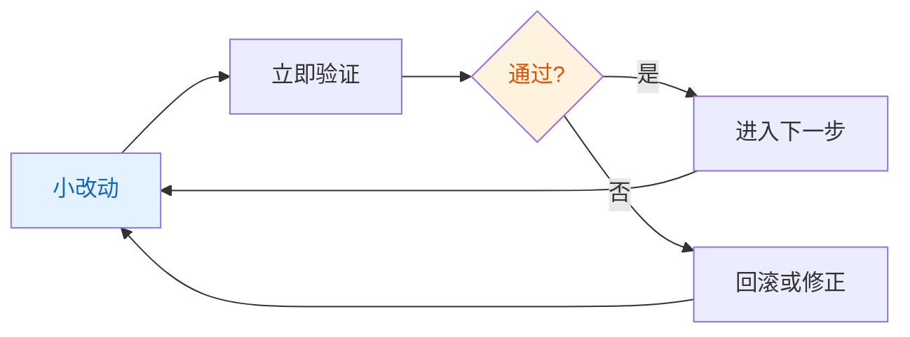
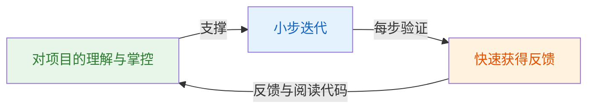

> **核心观点**：在 AI 编程时代，速度有两个层面：模型输出速度（能力在线的前提下，越快越好）和整个开发循环的周期（写、构建、测试、部署、回滚，任何一环慢都会拖垮小步迭代）。但速度不是目的，而是方法的前提：它之所以重要，是因为它让"小步迭代"真正可行。小步迭代比大批量修改更有效，前提是每一步都有验证闭环，且开发者对项目有掌控力。速度、小步、掌控力互为因果，构成一个正循环。

---

## 一、AI 编程改变了"速度"的瓶颈

AI 编程让写代码这件事变快了。但"速度快"的价值到底在哪里，值得较真。

在传统开发里，写代码本身就是一笔绕不开的成本：从想法到代码需要人工翻译，写得慢，产出就慢。AI 把这个环节的成本大幅压低，生成一段可运行的代码往往只需要几秒钟。

但写代码从来不是软件交付的全部。写完之后还有验证、理解和判断：这段代码对不对？它会影响什么？它值得继续用，还是应该推翻重来？

于是速度的重心发生了变化：**"写"依然重要，但它不再是唯一决定速度的环节，验证和判断的权重迅速上升**。这意味着，讨论 AI 编程的速度，既不能只盯着生成速度，也不能忽视它：生成决定你多快拿到候选代码，验证决定你多快知道它能不能用。

DORA 的 2024 年报告也指向同一个方向：AI 的采用显著提升了个人的生产力、心流体验和工作满意度，但同时也对软件交付的稳定性和吞吐产生了负面影响。写得更多，并不自动等于交付得更好。

本文想理清的就是这条逻辑链：为什么在 AI 编程时代速度更重要，以及这种"快"究竟快在哪里。

---

## 二、速度的第一个层面：模型输出速度

先看最直接的一层：模型输出速度。前面说速度的重心会向验证和判断倾斜，但这并不意味着生成速度不再重要。恰恰相反：**在模型能力基本在线的前提下，输出速度越快越好**。因为生成环节省下的每一秒，都会变成更多的迭代机会——而小步迭代的价值，正是靠次数累积出来的。

### 2.1 输出速度由两个指标决定

LLM 的响应不是一个瞬间完成的动作，而是分成两段：

| 指标 | 含义 | 对应的体验 |
|------|------|-----------|
| **TTFT**（首 token 延迟） | 从发出请求到收到第一个 token 的时间，包含排队、prefill 和网络延迟 | 决定"要等多久才开始" |
| **输出速度**（tokens/s） | 首 token 之后持续生成的平均速率，约等于 TPOT（ITL）的倒数 | 决定"读完要多久"，也决定流式阅读是否顺畅 |

端到端延迟约等于 `TTFT + 输出 token 数 ÷ 输出速度`。任何一个慢，体验都会明显变差；对交互式编码来说，TTFT 决定起步等待，输出速度决定总时长和阅读节奏。


### 2.2 为什么快直接关系到心流

人机交互有一个经典的经验阈值（Nielsen，1993）：

- **0.1 秒**：感觉像瞬时响应；
- **1 秒**：思路不被打断，但能感觉到延迟；
- **10 秒**：注意力开始离开当前任务。

LLM 的响应时间通常在几秒到几十秒之间，正好跨越了 Nielsen 的 1 秒和 10 秒两个阈值：低于 1 秒能保住心流，超过 10 秒注意力就开始流失。一次等待几秒还是几十秒，直接影响开发者是否保持专注、是否愿意继续做下一个小步。DORA 的 2024 年报告把"心流"列为 AI 带来的收益之一；而 Nielsen 的阈值提醒我们，等待时间正是心流的直接敌人。

更关键的是，输出速度会被迭代次数放大：每一步省下几十秒，一天几十次小步迭代，省下的就是持续的专注和更多的验证机会。

### 2.3 前提是能力在线

这个结论有一个前提：**模型能力基本在线**。如果能力不达标，输出越快，只会越快地产出需要重写的东西——速度会放大已有的方向，但不会替你决定方向。能力决定方向，闭环和掌控力校正方向，速度只是放大器。

### 2.4 对选型和实践的启示

- **选型不只看分数**：对交互式编码，除了 benchmark 能力分，还要看 TTFT 和输出速度。一个能力略低但明显更快的模型，在"能力已够用"的任务上往往更划算。
- **用流式输出**：让 token 边生成边返回，人可以在第一时间开始阅读和判断，感知延迟会明显降低。但流式只改善感知，真正的总时间仍然是 `TTFT + 生成时间`。
- **减少无效输出**：让模型少寒暄、直接给代码或 diff，效果上等同于提速——总时间取决于"输出 token 数 ÷ 速度"，把 token 数降下来和把速度提上去同样有效。

---

## 三、速度的第二个层面：缩短整个循环

模型输出速度只是循环里的一环。把视角拉远，"速度快"应该指**整个循环的周期短**，而不只是其中的"写代码"环节快：

```
写代码 → 构建 → 测试 → 部署 → 观察 → 反馈 → 修正或回滚
```

任何一环慢，整圈的周期就长，小步迭代的固定开销就高。DORA 在总结小批量实践时也指出，人们之所以倾向于大批量工作，一个重要原因正是交接变更的固定成本太高——"一次做完"看起来更省事，但那只是把成本推迟到了后面。

所以真正值得投资的速度来自这些地方：

- 快速的构建与 CI；
- 可靠、快速的自动化测试；
- 一键部署与一键回滚；
- 足够的可观测性，让反馈来得快；
- 清晰的模块边界，让每次改动的影响面可预测。

这些投入的回报不是"更快地写"，而是"更快地知道对不对"。对迭代来说，后者才是决定性的。DORA 的研究也支持这个判断：**小批量地工作是软件交付效能和组织效能的预测因素**，而缩短反馈时间正是它起作用的关键机制之一。

---

## 四、小步迭代不是快速堆债

前面两节都在说速度的价值。但"快"本身也常常被质疑：快速迭代，不就是快速堆技术债吗？

这个担心听起来合理，但它混淆了两件事：**小步迭代**和**小步提交**。前者是有验证的推进方式，后者只是把同一堆改动分几次写完。真正让代码越改越乱的，往往不是"步子小"，恰恰是"步子太大"。

### 4.1 大批量修改为什么更容易失控

一次性实现一个大功能，问题不在于工作量本身，而在于三个后果同时发生：

| 后果 | 说明 |
|------|------|
| **改动面大** | 一次触碰多个模块，任何一处判断失误都会向外扩散 |
| **反馈延迟** | 从动手到"知道对不对"，中间隔了很长时间 |
| **理解跟不上** | 代码被快速生成，人还没建立起对它的稳定模型 |

这三者会互相强化：反馈越迟，问题暴露得越晚；问题暴露得越晚，越容易选择继续打补丁；补丁越多，结构越乱，理解越难。


所以"越改越乱"不是速度造成的，而是**缺少及时反馈的改动**造成的。一次性实现大功能，只是把反馈延迟到了最后一刻。

### 4.2 小步提交 vs 小步迭代

小步迭代的逻辑正好相反：每一步都很小，每一步都能被检查，问题在还很小的时候就被发现。但这里有一个关键区分：

- **小步提交**：只是把改动分几次提交，每一步没有验证，错误照样累积；
- **小步迭代**：每一步都有验证，通过才进入下一步，不通过就回滚或修正。

真正的分界线不是步子的大小，而是**每一步有没有闭环**。

---

## 五、验证闭环：小步迭代的底线

一个完整的闭环至少包含三件事：

1. **能跑**：改动之后代码可以执行。这是最强的正确性信号，不可替代。
2. **能测**：有自动化测试验证行为，而不是靠人工点一遍。测试是每一步的验收标准。
3. **能回滚**：出错时能快速退回上一个可用状态。回滚成本足够低，人才敢把步子迈小。

三者缺一，小步迭代就会退化成小步提交：代码在往前挪，但没人知道它是不是在往正确的方向挪。



---

## 六、掌控力：小步迭代的前提

要让小步迭代真正有效，还有一个更根本的前提：**开发者必须对项目有掌控能力**。

掌控力至少包含三层：

| 层次 | 含义 |
|------|------|
| **结构认知** | 知道项目如何组织、模块边界在哪里、依赖关系如何 |
| **影响面判断** | 改一个地方之前，能预判它会波及哪些模块 |
| **代码判断力** | 能读懂 AI 生成的代码，并判断它是否合理 |

没有掌控力，小步迭代就会变成盲改：你确实每次只改一点，但你不知道这一点改得对不对，也不知道下一刀该往哪里切。这和[《AI 编程不是许愿》]()里说的是同一件事——AI 降低了写代码的门槛，但没有消除判断的成本。

AI 在这里有双重效应：它让代码产出变快，也让"失控"变快。生成得越快，如果理解跟不上，积累的未知代码就越多，掌控力反而下降得越快。DORA 的研究也发现，AI 的采用常常伴随交付不稳定性的上升，而小批量正是这个风险的关键对策——它让"生成得更快"转化为价值，而不是混乱。

值得强调的是，掌控力不只是小步迭代的"资格证"，也是它的产物。**你对一个模块的理解，往往是在一次次小改动中长出来的**：为了改对它，你必须先读懂它；读懂了，下一次改动就更小、更准。

---

## 七、正循环：理解和迭代互相成就

把上面的讨论串起来，会看到一个正循环：



- 有掌控力，才敢把改动切小；
- 切得小，每一步都能验证，反馈来得快；
- 反馈来得快，理解和掌控力又进一步加深。

反过来，大批量修改会让这个循环断裂：因为反馈太迟，你始终没有机会建立对代码的稳定理解，掌控力只能停留在表面。这与[《开发者能力 × Code Agent 能力利用阶段》]()中把"闭环设计"列为最高阶段核心能力的判断一致：真正拉开差距的，不是 Agent 生成得多快，而是开发者能否设计出"执行 → 验证 → 反馈 → 改进"的完整闭环。

所以，小步迭代不只是一种交付方式，它也是**建立掌控力的手段**。这可能是它比"更快"更重要的地方。

---

## 八、结论

回到最初的问题：AI 编程时代，为什么速度更重要？

因为速度不是目的，而是方法的前提。

- 速度有两个层面：模型输出速度（能力在线时越快越好）和整个循环的周期（写、构建、测试、部署、回滚）；
- 但速度只有配上小步迭代才有意义——小步迭代比大批量修改更有效，它把风险、验证和理解都切成小块；
- 小步迭代要跑起来，每一步必须有验证闭环——能跑、能测、能回滚；
- 验证闭环要有意义，开发者必须对项目有掌控力——否则只是盲改；
- 而掌控力又来自一次次有反馈的小步迭代——理解和迭代互为因果。

速度让"小步"变得便宜，小步让"理解"变得可能，理解又让"下一步"变得更小。这个正循环转起来，代码不会越改越乱，产品才可能持续快速迭代。

反过来，如果没有验证闭环和掌控力，再快的生成速度也只会让代码更快地失控。

---

## 术语表

| 术语 | 说明 |
|------|------|
| **小步迭代** | 把改动切成小而完整的单元，每一步都经过验证后再继续 |
| **小步提交** | 只把改动分几次提交，但每一步没有验证，错误照样累积 |
| **验证闭环** | 改动 → 执行 → 测试 → 反馈 → 修正或回滚 的完整回路 |
| **技术债** | Technical Debt，为了短期交付做出的妥协，未来需要额外成本偿还 |
| **TTFT** | Time To First Token，从发出请求到收到第一个 token 的时间 |
| **Prefill** | 模型生成第一个 token 之前，对输入提示进行预处理的阶段，是 TTFT 的主要来源之一（TTFT 还包含排队和网络延迟） |
| **TPOT / ITL** | Time Per Output Token / Inter-Token Latency，相邻输出 token 的平均间隔，其倒数约等于输出速度 |
| **流式输出** | Streaming，模型边生成边返回 token，而不是等全部生成完再一次性返回 |
| **CI** | Continuous Integration，持续集成，频繁集成代码并自动构建、测试 |
| **可观测性** | Observability，通过日志、指标、链路追踪观察系统真实运行状态的能力 |
| **回滚** | Rollback，把系统退回到上一个已知可用的版本 |

---

## 参考文献

1. Forsgren, N., Humble, J., & Kim, G. *Accelerate: The Science of Lean Software and DevOps: Building and Scaling High Performing Technology Organizations*. IT Revolution, 2018. — 关于小批量、快反馈与交付效能关系的研究。
2. Humble, J., & Farley, D. *Continuous Delivery: Reliable Software Releases through Build, Test, and Deployment Automation*. Addison-Wesley Professional, 2010. — 小步交付、自动化测试与可回滚部署的工程实践。
3. DORA. *Working in small batches*. https://dora.dev/devops-capabilities/process/working-in-small-batches/ — 小批量作为交付效能预测因素的实证结论，及其对 AI 采用风险的缓冲作用。
4. DORA. *Accelerate State of DevOps Report 2024*. https://dora.dev/research/2024/dora-report/ — AI 提升生产力但影响交付稳定性，小批量与稳健测试仍是关键基础。
5. OpenTelemetry. *Observability Primer*. https://opentelemetry.io/docs/concepts/observability-primer/ — 可观测性的信号来源：traces、metrics、logs。
6. Nielsen, J. *Response Times: The 3 Important Limits*. Nielsen Norman Group, 1993. https://www.nngroup.com/articles/response-times-3-important-limits/ — 0.1 秒 / 1 秒 / 10 秒的交互响应阈值。
7. NVIDIA. *Metrics — NVIDIA NIM LLMs Benchmarking*. https://docs.nvidia.com/nim/benchmarking/llm/latest/metrics.html — TTFT、ITL/TPOT 与端到端延迟的定义。
8. Redis. *LLM Speed Benchmarks: Metrics & Infrastructure Guide*. 2026. https://redis.io/blog/llm-speed-benchmarks/ — 输出速度对流式阅读体验的影响。
9. Redis. *Streaming LLM Responses: Make Your AI App Feel Fast*. 2026. https://redis.io/blog/streaming-llm-responses/ — 流式输出降低感知延迟，但不改变总生成时间。
10. 本博客《[AI 编程不是许愿：从王垠争议看“懂计算机科学”的价值]()》. 2026. — 判断力与反馈控制。
11. 本博客《[开发者能力 × Code Agent 能力利用阶段]()》. 2026. — 闭环设计与自迭代。
