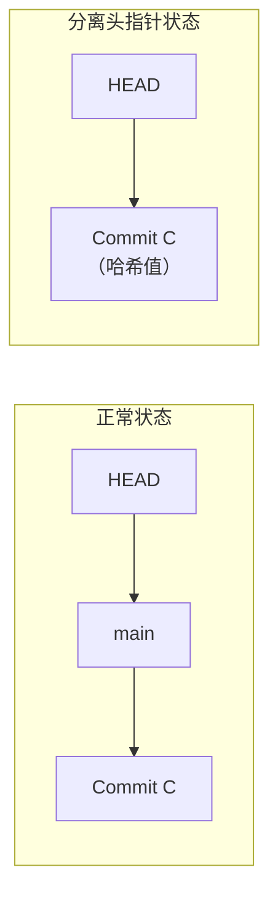
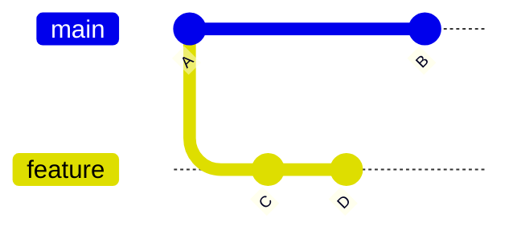
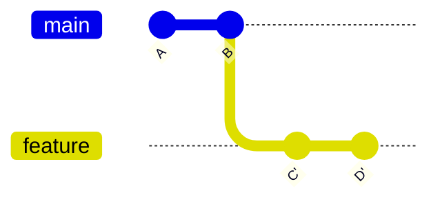
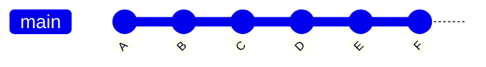

`git checkout <commit-hash>` 和 `git checkout <branch-name>` 表面上看都是"跳转到某个代码状态"，但背后的核心机制和后续影响有着巨大的区别。

简单来说：切分支是"正常工作流"，切 Commit 是"临时穿梭机"。

## 一、checkout 的本质：指向的是分支名，还是提交哈希

### 稳定状态：`git checkout <branch-name>`

当你切换到分支（比如 `main`）时，HEAD 指向的是 `main` 这一条"软链接"，而 `main` 再指向最新的 Commit。

当你提交新代码时，HEAD 跟着 `main` 一起自动向前移动。你的修改被安全地记录在分支线上。

### 分离状态：`git checkout <commit-hash>`

当你切换到一个具体的 Commit ID 时，HEAD 直接绕过分支，插在了那个 Commit 上。这就触发了 Detached HEAD（分离头指针）状态。



这时你依然可以修改代码并执行 `git commit`。但致命危险在于：新生成的 Commit 不属于任何分支。如果你突然执行 `git checkout main` 切回主分支，刚刚在分离状态下写的代码就会变成"无家可归的孤儿 Commit"，过一段时间会被 Git 的垃圾回收机制彻底清理掉。

### 正确做法

只是想看一眼过去的代码，用 `git checkout <commit-hash>`。看完之后 `git checkout <branch-name>` 回到现实世界。

想基于过去的某个 Commit 改 Bug 或开发新功能，在那个 Commit 上建立一个新分支：

```bash
git checkout -b my-fix <commit-hash>
```

这样 HEAD 就会安全地指向新分支，可以像平时一样放心提交代码。

补充说明：较新版本的 Git 推荐使用 `git switch <branch-name>` 切换分支，`git checkout <commit>` 查看特定提交，指令语义上区分得更清晰。

### 只想要某个 Commit 的改动：用 cherry-pick 代替 checkout

如果你不需要在那个 Commit 里修改代码，只是想把它的变更复制到当前分支，不必切过去。

```bash
# 当前在 main 分支，把 Commit X 的改动应用到 main 上
git cherry-pick <commit-X>
```

`cherry-pick` 的本质是在当前分支上生成一个新提交，内容与被指定的那个 Commit 相同。它不改变 HEAD 的状态，也不会触发 Detached HEAD，是"拿走某个 Commit 的改动"最安全的方式。

## 二、checkout、reset、rebase 行为对比

下面用一张表格和后续的详细拆解，说明三个命令在两种状态下的关键差异。

| 操作 | 正常分支状态 | 分离头指针状态 |
| :--- | :--- | :--- |
| `checkout <commit>` | HEAD 指向分支 → 分支指向 Commit | HEAD 直接指向 Commit（Detached HEAD） |
| `checkout <branch>` | HEAD 指向分支 | 回到分支，丢失分离状态下的未保存提交引用 |
| `reset <commit>` | 分支指针和 HEAD 一起移动到目标 Commit | 仅 HEAD 移动到目标 Commit，无分支受影响 |
| `rebase <branch>` | 当前分支被线性化重放到目标分支上 | 提交被重放，但结果仍在 Detached HEAD 上，极易丢失 |
| `cherry-pick <commit>` | 在当前分支上生成一个新提交 | 同左（不产生 Detached HEAD） |
| `bisect` (start / bad / good) | 不适用 | 自动进入 Detached HEAD 进行二分查找，`bisect reset` 后安全返回原分支 |

## 三、git reset 在不同状态下的行为

### 正常分支：分支指针和 HEAD 一起移动

执行 `git reset <commit-Y>`，Git 会把 `main` 分支的指针强行拉回到 commit-Y，HEAD 也跟过去。`main` 分支在 commit-Y 之后的所有提交都会变成"孤儿提交"。

### 分离头指针：只有 HEAD 移动

执行 `git reset <commit-Y>`，仅仅把 HEAD 从当前 Commit 拔下来，插到了 commit-Y 上。因为没有分支与 HEAD 绑定，没有任何分支指针发生变化。这就像在历史记录里做了一次"瞬移"，非常安全。

### 核心参数的影响

无论在哪种状态下，`--soft`、`--mixed`、`--hard` 对工作区和暂存区的影响是一致的：

| 参数 | 改变指针？ | 改变暂存区？ | 改变工作区？ |
| :--- | :--- | :--- | :--- |
| `--soft` | 是 | 否 | 否 |
| `--mixed`（默认） | 是 | 是 | 否 |
| `--hard` | 是 | 是 | 是 |

在正常分支上 `git reset --hard` 会抹除分支上的历史提交和本地未提交代码，必须小心。在分离头指针状态下，想"切换"到另一个 Commit 看看，继续使用 `git checkout <另一个commit>` 才是更规范的做法。

## 四、git rebase 在不同状态下的行为

`git rebase <target-branch>` 的核心逻辑是：把我当前所在分支/Commit 上的独特修改，剪切并粘贴到目标分支的最新提交后面。

### 正常分支：安全可靠

假设你在功能分支 `feature` 上，它比 `main` 多了两个提交 C 和 D：



执行 `git rebase main` 后，feature 的提交被重放到 B 之后：



提交 C 和 D 被重放为 C' 和 D'，`feature` 分支指针和 HEAD 一起移动到最新的 D' 上。工作流完美，安全可靠。

### 分离头指针：结果仍在 Detached HEAD 上

执行 `git checkout <commit-D>` 后处于分离头指针状态，HEAD 直接指向 D，没有分支名绑在上面。

执行 `git rebase main` 后，Git 依然能把 C 和 D 粘贴到 B 后面生成 C' 和 D'。但由于没有分支绑定，Git 只会把 HEAD 指针移动到新生成的 D' 上——依然处于分离头指针状态。

如果你此时执行 `git checkout main` 切回主分支，刚变基好的 C' 和 D' 瞬间变成孤儿提交，在 Git 的历史洪流中迷失。

### 黄金法则

正常分支下 rebase 是日常合并代码、整理历史的标准动作。分离头指针下 rebase 极不推荐。如果你发现自己处于 Detached HEAD 状态，又想把当下的修改 rebase 到主分支，请务必先建一个临时分支接住它：

```bash
git checkout -b temp-branch
git rebase main
```

## 五、git bisect：Detached HEAD 最经典的合法用例

`git bisect` 是 Git 里少数有意使用 Detached HEAD 的内置功能，也是最安全的用例。

当你在某个分支上发现一个 Bug，确定它在某个较老的版本还不存在时：

```bash
# 当前在 main 分支
git bisect start
git bisect bad          # 当前版本有 Bug
git bisect good <commit> # 这个旧版本没有 Bug
```

Git 会在当前 Commit 和指定 Commit 之间做二分查找，每次 checkout 到中间的那个 Commit，自动进入 Detached HEAD。你测试后标记 `git bisect good` 或 `git bisect bad`，Git 继续缩小范围，直到找到第一个引入 Bug 的 Commit。



假设你知道 Bug 在 F 上，但 A 是好的。执行 `bisect` 后 Git 会先 checkout 到 D，标记后定位到 B 或 C 与 D 之间，逐步逼近。

完成查找后：

```bash
git bisect reset   # 安全回到原分支
```

这个过程完全安全，原因有两点：

- `bisect` 检出的每个 Commit 都是只读查看，你不需要在上面提交代码。
- `git bisect reset` 会自动清理 Detached HEAD，把你送回之前所在的分支。

如果想在 bisect 过程中修改代码，也请先在当前 Commit 上建分支：

```bash
git checkout -b bisect-fix
# 改代码、提交
```

## 六、如何抢救丢失的提交：git reflog

前面几节反复警告 Detached HEAD 下的提交会丢失。但 Git 并没有真正立即删除它们——它给了你一个缓冲期，可以通过 `git reflog` 抢救。

### reflog 是什么

`reflog`（Reference Log）记录了 HEAD 和分支指针在过去一段时间内的每一次移动。默认情况下，可达（reachable）提交的记录保留 90 天，不可达（unreachable）的记录保留 30 天（具体时长由 `gc.reflogExpire` 和 `gc.reflogExpireUnreachable` 控制）。

### 实战：找回 Detached HEAD 中丢失的提交

假设你忘记了"先建分支"的忠告，在 Detached HEAD 状态下提交了几个 Commit，然后手快执行了 `git checkout main`，新提交再也看不到了。

```bash
# 1. 查看 HEAD 的移动历史
git reflog

# 输出可能像这样：
# a1b2c3d (HEAD -> main) HEAD@{0}: checkout: moving from a1b2c3d to main
# e4f5a6b HEAD@{1}: commit: 我在 Detached HEAD 下的提交
# b7c8d9e HEAD@{2}: commit: 另一个修改
# f0a1b2c HEAD@{3}: checkout: moving from main to f0a1b2c
```

`HEAD@{1}` 和 `HEAD@{2}` 就是你在分离头指针状态下提交的 Commit。记下它们的哈希值：

```bash
# 2. 用分支接住它们
git checkout -b recovered-work e4f5a6b
```

现在 `recovered-work` 分支指向了你之前丢失的那个 Commit，所有改动都回来了。

如果丢失的是一串连续的提交（你提交了多次才切走），可以用 `git merge` 或 `git rebase` 把整条线接回来：

```bash
# 先切到最近的提交建分支
git checkout -b recover-all HEAD@{1}
# 这个分支就包含了你在 Detached HEAD 期间的所有提交
```

### reflog 的局限性

- reflog 是基于仓库本地的日志，不会被 `git push`、`clone` 或 `fetch` 带走的。换一台机器就找不到了。
- 超过保留期的提交会被 Git 的垃圾回收（`git gc`）彻底清理，不可恢复。
- `git gc` 也可能被手动触发，或由某些常见命令（如 `git commit`、`git merge`、`git rebase`）在操作后自动执行 `git gc --auto` 间接触发。

所以 reflog 是救命稻草，但不能当日常依赖。预防永远比抢救简单。

## 结语

理解 Detached HEAD 的关键在于认清：`checkout`、`reset`、`rebase` 在操作"指针"，而指针的锚点（分支名）决定了修改能否被安全地保留。没有分支名接住的提交，无论来自 checkout 后的提交、reset 后的历史变更，还是 rebase 后的重放结果，本质上都是浮在 Git 图里的孤儿节点。

日常开发中可以遵循三条原则：

- **只想查看**：`git checkout <commit>` 看，看完 `git switch <branch>` 回去。
- **只要改动**：用 `cherry-pick`，不切换过去也能拿到变更。
- **要写新代码**：先建分支，哪怕是个临时名字。

如果万一丢了提交，别慌，`git reflog` 在 30 天内都还有机会找回来。
