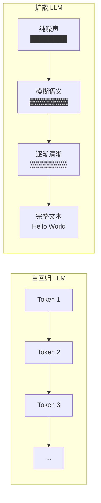
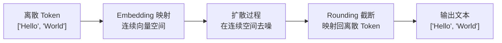
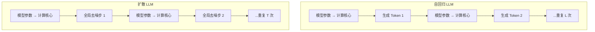
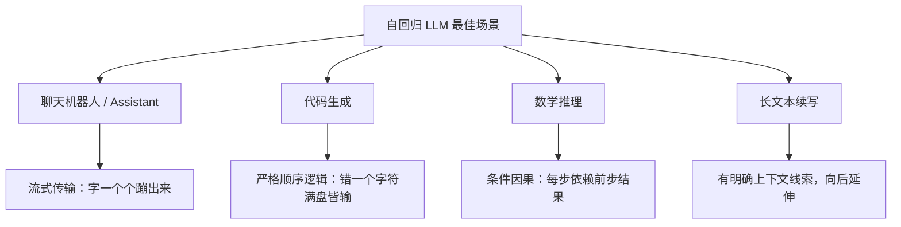
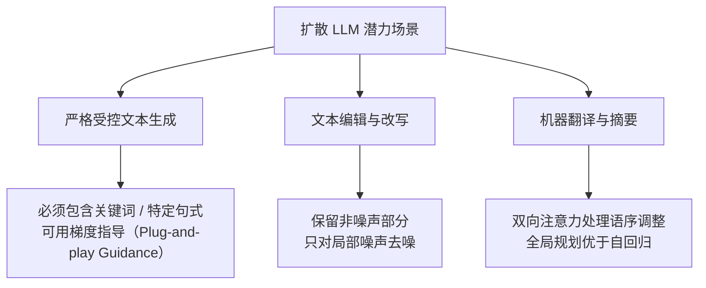
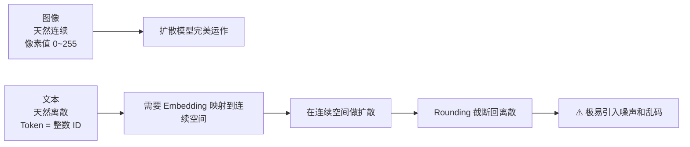
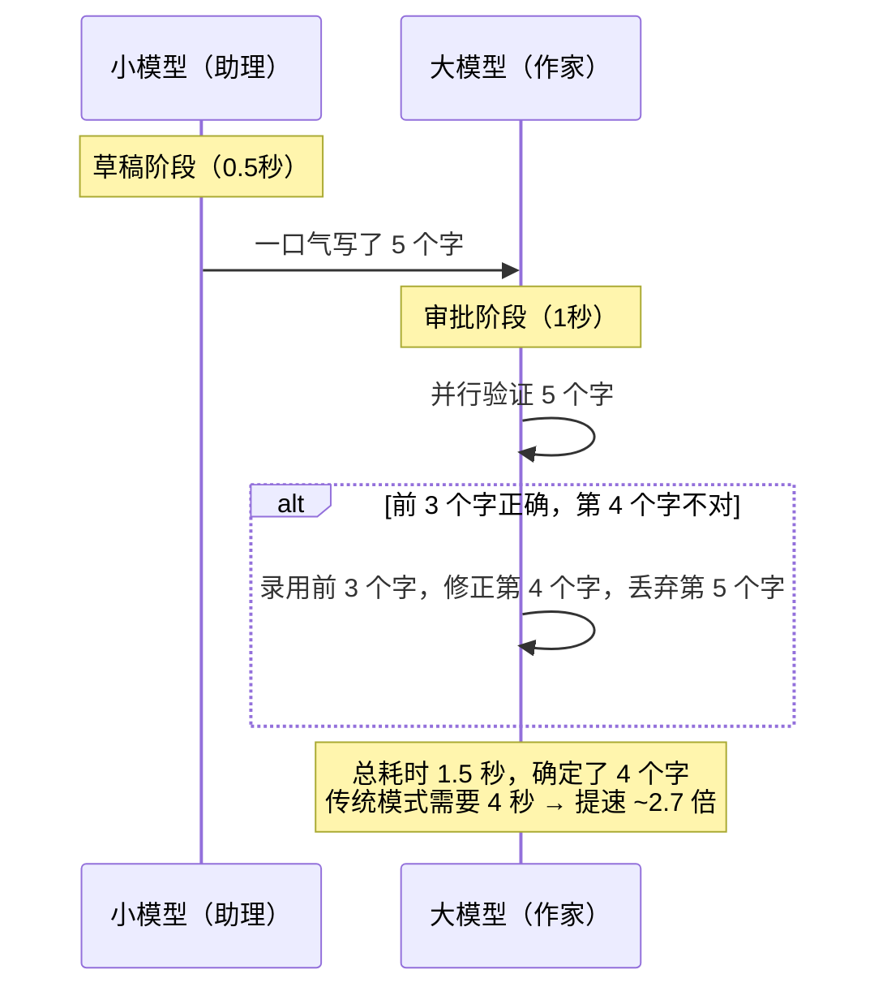
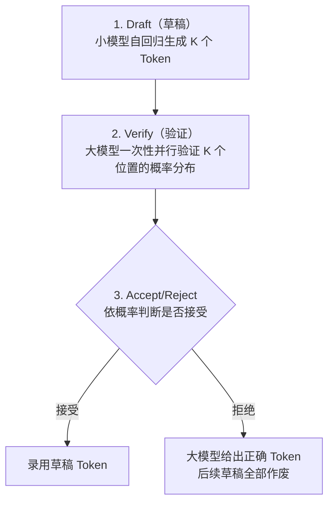
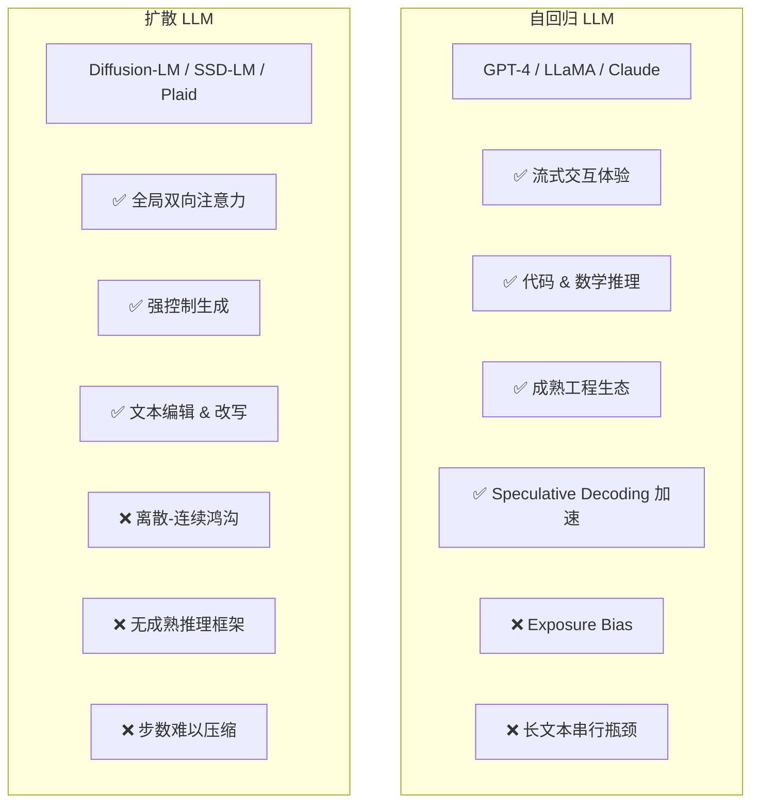

> **核心观点**：自回归 LLM 是"自左向右、逐字蹦字"的线性叙事者；扩散 LLM 是"由模糊到清晰、全局淡入"的画布渲染者。两者在生成机制、计算复杂度和适用场景上存在根本性差异——理解这些差异，是判断下一代 AI 基础设施走向的关键。

---

## 一、两种范式的本质区别

文本生成领域长期被自回归模型（GPT、LLaMA、Claude 等）统治。但近年来，研究者将图像领域的扩散模型引入文本生成（如 Diffusion-LM、SSD-LM、Plaid），形成了一条全新的技术路线。

二者的根本区别在于**信息释放的方式**：



---

## 二、核心框架与生成机制

### 2.1 自回归 LLM：条件概率的链式展开

自回归模型的核心思想是**逐 Token 条件生成**——基于前 $t-1$ 个 Token 预测第 $t$ 个 Token：

$$P(x_1, x_2, \dots, x_L) = \prod_{t=1}^{L} P(x_t \mid x_1, x_2, \dots, x_{t-1})$$

在 Transformer 架构中，这通过**因果注意力掩码（Causal Attention Mask）** 实现：每个 Token 只能看到自己及左侧的所有 Token，右侧信息被完全屏蔽。

```
因果注意力矩阵（4个Token）：

        Token1  Token2  Token3  Token4
Token1  [  1      0      0      0  ]
Token2  [  1      1      0      0  ]
Token3  [  1      1      1      0  ]
Token4  [  1      1      1      1  ]

→ 下三角矩阵，严格限制信息流向
```

### 2.2 扩散 LLM：从噪声到文本的迭代去噪

扩散语言模型借鉴了图像扩散模型（DDPM）的思想，将文本生成建模为一个**迭代去噪过程**：

1. **前向过程（加噪）**：将真实文本通过多步噪声注入，逐步退化为纯噪声
2. **反向过程（去噪）**：从纯噪声出发，通过训练好的去噪网络逐步还原文本

DDPM 的反向过程每一步为：

$$x_{t-1} = \frac{1}{\sqrt{\alpha_t}}\left(x_t - \frac{1-\alpha_t}{\sqrt{1-\bar{\alpha}_t}} \epsilon_\theta(x_t, t)\right) + \sigma_t z, \quad z \sim \mathcal{N}(0, I)$$

其中 $\alpha_t$ 为噪声调度参数，$\bar{\alpha}_t = \prod_{s=1}^t \alpha_s$，$\epsilon_\theta$ 为去噪网络预测的噪声，$\sigma_t z$ 为添加的随机噪声。简化理解：**每一步用神经网络预测当前噪声，然后从 $x_t$ 中减去预测噪声，逐步还原出干净文本**。

#### 离散文本的连续化处理

图像是天然连续的（像素值 0~255），但文本是离散的 Token。扩散 LLM 需要解决的核心问题是**离散-连续映射**：



> **关键难点**：最后的 Rounding（截断）操作极易引入噪声和乱码。图像少一个像素人类依然能看懂，但文本改动一个字（如"要"变"不要"），语义彻底相反。

### 2.3 机制对比总结

| 特性 | 自回归 LLM | 扩散 LLM |
|------|-----------|---------|
| 生成机制 | 自回归，逐 Token 条件生成 | 迭代去噪，全局逐步还原 |
| 建模对象 | 离散 Token 的条件概率分布 | 连续嵌入空间或离散文本空间的去噪 |
| 注意力机制 | **因果注意力**：只看左侧 | **双向注意力**：每步都能看全局上下文 |
| 信息释放 | 线性展开，从左到右 | 全局淡入，从模糊到清晰 |
| 纠错能力 | 极差，"将错就错"（Exposure Bias） | 极强，早期阶段可全局修正 |
| 生成顺序 | 严格自左向右 | 无固定顺序，全局并行 |

---

## 三、计算复杂度：公式推导与对比

这是理解两者落地差异的核心。我们从**时间复杂度（FLOPs）** 和**空间复杂度（内存带宽）** 两个维度进行定量分析。

### 3.1 符号定义

| 符号 | 含义 |
|------|------|
| $L$ | 生成的目标文本总长度（Token 数） |
| $T$ | 扩散 LLM 的总去噪步数（通常 20~200） |
| $D$ | 模型隐藏层维度（Hidden Dimension） |
| $N$ | Transformer 层数（Layers） |
| $i$ | 当前自回归生成的第 $i$ 个 Token |

> **预备知识**：一个标准 Transformer 层处理单 Token 的前向传播计算量约为 $16D^2$。具体构成：QKV 投影 $6D^2$（三个 $D \times D$ 矩阵各 $2D^2$）+ 注意力输出投影 $2D^2$ + FFN 两层 $8D^2$（两个 $D \times 4D$ 矩阵各 $4D^2$）。此外，注意力点积（Q×K^T 和加权求和 V）每步额外贡献 $2 \cdot D \cdot L_{\text{seq}}$，但在 $D \gg L_{\text{seq}}$ 时通常可忽略。
>
> **注意**：著名的"$6N$"公式（$N$ 为非 Embedding 参数数）是**训练时**每 Token 的 FLOPs 估计（含前向 + 反向传播），其中前向约 $2N$、反向约 $4N$。纯推理（仅前向）的每层每 Token FLOPs 约 $16D^2$，而非 $6D^2$。[参考：Google DeepMind Scaling Book](https://jax-ml.github.io/scaling-book/transformers/)
>
> **MLP 变体说明**：上述 FFN 按标准两矩阵（$W_{\text{in}}, W_{\text{out}}$）计算。现代 LLM（如 LLaMA、DeepSeek）常采用**门控 MLP（Gated MLP）**，使用三个矩阵（$W_{\text{in1}}, W_{\text{in2}}, W_{\text{out}}$），此时 FFN 的 FLOPs 为 $12D^2$，每层总计 $20D^2$。本文后续统一按 $16D^2$（标准两矩阵）计算，使用门控 MLP 时需将 $D^2$ 项系数乘以 $1.25$。

### 3.2 训练复杂度对比

在讨论推理之前，先看两者的训练差异——这直接影响了模型的迭代速度和研发成本。

#### 自回归 LLM：Teacher Forcing 并行训练

自回归模型训练时采用 **Teacher Forcing**：将整条真实文本一次性输入模型，通过因果 Mask 并行计算所有位置的 Loss。这意味着：

- 一条长度 $L$ 的文本，**1 次前向传播 + 1 次反向传播** 即可计算全部 $L$ 个位置的梯度
- 训练效率极高，与文本长度几乎无关（GPU 并行）
- 这也是自回归 LLM 能快速迭代到万亿参数规模的关键原因之一

#### 扩散 LLM：多噪声步数训练

扩散模型训练时需要对每条文本采样不同的噪声步数 $t \in [1, T]$，然后训练去噪网络预测噪声：

- 每条文本在训练时会被采样到不同的 $t$，需要多次前向传播才能充分训练
- 额外开销：需要将离散 Token 映射到连续 Embedding 空间，再从连续空间映射回离散 Token
- 训练相对稳定，但迭代速度慢于自回归

**结论**：自回归 LLM 的训练效率显著高于扩散 LLM，这是其能快速规模化的重要因素。

### 3.3 自回归 LLM 的推理 FLOPs

在标准商业部署中，自回归模型开启 **KV Cache**。此时生成第 $i$ 个 Token 时：

- **矩阵乘法部分**：KV Cache 避免了重复计算历史 Token 的 KV，只需对当前 1 个 Token 做 Projection，计算量固定为 $16ND^2$（QKV $6D^2$ + 输出投影 $2D^2$ + FFN $8D^2$，共 $N$ 层）
- **注意力部分**：当前 Token 需要与前面所有 $i-1$ 个 Token 的 KV 做点积，计算量为 $2NDi$

因此，生成第 $i$ 个 Token 的计算量为：

$$\text{FLOPs}_i \approx 16ND^2 + 2NDi$$

生成完整长度 $L$ 的总文本，累加 $i$ 从 1 到 $L$（利用 $\sum_{i=1}^{L} i \approx \frac{1}{2}L^2$）：

$$\boxed{\text{Total FLOPs}_{\text{AR}} \approx 16ND^2L + NDL^2}$$

**关键特征**：
- 当 $L$ 较小时，第一项 $16ND^2L$ 占主导，复杂度近似 $O(L)$
- 当 $L$ 极大时，第二项 $NDL^2$ 显现，呈现 $O(L^2)$ 增长
- 但由于 $D \gg L$ 通常成立，实际中第一项往往主导

### 3.4 扩散 LLM 的推理 FLOPs

扩散 LLM 采用**双向注意力**。在每一个去噪步 $t$（共 $T$ 步），模型对长度为 $L$ 的整段文本同时做一次完整前向传播。它**无法使用 KV Cache**，因为每一步所有 Token 都在变化。

单步去噪（长度 $L$）的计算量：

- **矩阵乘法部分**：$16ND^2L$（与 AR 相同的每层每 Token 计算，但同时处理 $L$ 个 Token）
- **注意力全局计算**：$2NDL^2$（双向注意力，每个 Token 与所有 $L$ 个 Token 做点积）

总共迭代 $T$ 步，总计算量为：

$$\boxed{\text{Total FLOPs}_{\text{Diff}} \approx T \cdot (16ND^2L + 2NDL^2) = 16ND^2LT + 2NDL^2T}$$

**关键特征**：复杂度固定为 $O(T \cdot L^2)$，因为每次都是全局计算，计算量直接引入了放大系数 $T$。

### 3.5 公式对比

| 模型 | 总 FLOPs 公式 | 复杂度 |
|------|--------------|--------|
| 自回归 LLM | $16ND^2L + NDL^2$ | 短文本 $O(L)$，长文本 $O(L^2)$ |
| 扩散 LLM | $16ND^2LT + 2NDL^2T$ | 固定 $O(T \cdot L^2)$ |

### 3.6 谁更快？——临界点分析

假设 $N=32, D=4096$，对比不同文本长度 $L$ 下的总计算量（$T=50$）：

| 文本长度 $L$ | AR 总 FLOPs | Diff 总 FLOPs | 差距 |
|-------------|------------|--------------|------|
| 20（短句） | $\sim 1.7 \times 10^{11}$ | $\sim 8.6 \times 10^{12}$ | Diff 慢 ~50x |
| 200（段落） | $\sim 1.7 \times 10^{12}$ | $\sim 8.6 \times 10^{13}$ | Diff 慢 ~50x |
| 2000（长文） | $\sim 1.7 \times 10^{13}$ | $\sim 8.6 \times 10^{14}$ | Diff 慢 ~50x |

> **计算示例**（$L=20$）：AR = $16 \times 32 \times 4096^2 \times 20 + 32 \times 4096 \times 20^2 \approx 1.72 \times 10^{11}$；Diff = $50 \times (16 \times 32 \times 4096^2 \times 20 + 2 \times 32 \times 4096 \times 400) \approx 8.59 \times 10^{12}$。

**结论**：在当前技术条件下，扩散 LLM 的总计算量始终远大于自回归 LLM（差距约 $T$ 倍）。但扩散 LLM 的核心优势在于**并行性**——它可以用 GPU 的大规模并行能力换取墙钟时间（Wall-Clock Time），而自回归 LLM 受限于串行依赖。

#### 直觉性分析：短句 vs 长文

为了更直观地理解两者的效率差异，看一个具体例子：

| 场景 | 自回归 LLM | 扩散 LLM（$T=50$） | 谁更快？ |
|------|-----------|-------------------|---------|
| 短句（10 个词） | 10 次前向传播 | 50 次全局去噪 | **LLM 快 5 倍** |
| 长文（2000 个词） | 2000 次前向传播 | 50 次全局去噪 | **Diffusion 快 40 倍**（理论上） |

直觉上：自回归的步数随文本长度线性增长，而扩散的步数固定为 $T$。当 $L \gg T$ 时，扩散在"需要走几步"这件事上具有碾压级优势。但每一步的计算量扩散远大于自回归（全局计算 vs 单 Token 计算），因此**纯墙钟时间的胜负取决于 GPU 并行能力能否消化扩散每步的大计算量**。

### 3.7 空间复杂度与内存带宽

在工业界，推理速度往往不取决于计算量（Compute-Bound），而取决于**内存带宽（Memory-Bound）**——即显卡读取模型参数的速度。

#### 自回归 LLM：KV Cache 压力

自回归模型的最大瓶颈在于 KV Cache 的显存占用随 $L$ 线性增长：

$$\text{Memory}_{\text{KV Cache}} = 2 \times 2 \times N \times H \times D_{\text{head}} \times L \times B$$

其中 $2$ 代表 K 和 V，$2$ 代表 FP16 占 2 字节，$H$ 为注意力头数，$D_{\text{head}}$ 为头维度，$B$ 为 Batch Size。

每生成一个 Token，需要把整个模型参数从显存搬到计算核心一次——这是典型的 Memory-Bound 操作。

#### 扩散 LLM：无 KV Cache，但参数搬运 $T$ 次

扩散 LLM 不需要保存任何历史 KV Cache（全局更新），但每一步去噪都需要把整个模型参数重新读取一次，执行 $T$ 步意味着模型参数在显存和芯片之间来回搬运 $T$ 次。



### 3.8 推理效率的核心指标：串行步数

| 模型 | 前向传播总次数（串行依赖步数） | 长度敏感度 | GPU 利用率 |
|------|----------------------------|-----------|-----------|
| 自回归 LLM | $L$ 次 | 极高（越长越慢） | 低（每次只算 1 个 Token） |
| 扩散 LLM | $T$ 次 | 极低（长短文本步数接近） | 高（每次同时算 $L$ 个 Token） |

#### GPU 利用率的深层差异

自回归 LLM 的最大浪费在于：**每次前向传播只处理 1 个 Token**。现代 GPU 拥有数千个计算核心，但单 Token 的矩阵乘法无法填满这些算力——GPU 大部分时间在"空转"等待内存搬运（Memory-Bound）。这是为什么输出 Token 比输入 Token 贵 4~5 倍的根本原因。

扩散 LLM 则天然适合 GPU 并行：**每一步去噪都同时处理整段 $L$ 个 Token**，大矩阵乘法可以充分利用 GPU 的数千个计算核心（Compute-Bound）。理论上，扩散 LLM 的 GPU 利用率远高于自回归 LLM。

```
自回归 LLM 的 GPU 利用率：
┌──────────────────────────────────────┐
│ GPU 算力  ████████░░░░░░░░░░░░░░░░░░ │ ~20% 利用率
│ 内存带宽  ██████████████████████████ │ ~100% 瓶颈
└──────────────────────────────────────┘
→ 每次只算 1 个 Token，算力严重闲置

扩散 LLM 的 GPU 利用率：
┌──────────────────────────────────────┐
│ GPU 算力  ██████████████████████████ │ ~90% 利用率
│ 内存带宽  ████████████░░░░░░░░░░░░░░ │ ~50% 负载
└──────────────────────────────────────┘
→ 每次同时算 L 个 Token，算力充分压榨
```

**分水岭**：当 $L \gg T$ 时，扩散 LLM 在理论延迟上才会反超自回归 LLM。但现实中，自回归有 Speculative Decoding（实际串行步数远小于 $L$），而扩散的步数 $T$ 很难压缩到 10 步以内——因此自回归目前在工程落地中依然占据绝对优势。

---

## 四、落地场景对比

两者的特性差异导致了截然不同的最佳落地场景。

### 4.1 自回归 LLM 的黄金场景：流式与高逻辑交互



**聊天机器人与 Assistant**：用户需要"看着字一个个蹦出来"的流式体验，自回归天然契合。

**代码生成与数学推理**：代码和数学对严格的顺序逻辑要求极高，自回归的条件概率建模 $P(x_t | x_{<t})$ 更精准。

### 4.2 扩散 LLM 的潜力场景：强控制力与非自左向右任务



**严格受控文本生成**：要求生成文本必须包含某些关键词、符合特定句式。扩散模型允许在去噪过程中加入梯度指导（Plug-and-play Guidance），控制力远强于自回归 LLM。

**文本编辑与改写**：保留非噪声部分，只对局部噪声进行去噪，天然适合文本润色、语法纠错和局部重写。

**机器翻译与摘要**：中英文语序存在大幅度调整，双向注意力机制使得扩散模型处理全局语序规划理论上更优。

---

## 五、落地难度与工业界现状

### 5.1 为什么 Diffusion LLM 落地极其困难？

尽管扩散 LLM 有"全局规划、长文本推理速度快"的理论优势，但目前几乎处于实验室阶段，工业落地难度极大。

#### 难点一：离散与连续的鸿沟



目前的折中方案是将文本映射到高维连续 Embedding 空间做扩散，最后再用 Rounding 操作映射回 Token。这个过程极易导致模型生成无意义的词汇或病句。

#### 难点二：文本对微小扰动极度敏感

图像改动几个像素，人类依然能看懂；但文本改动一个字，语义可能彻底相反。扩散模型在去噪中期阶段的文本往往逻辑混乱，很难收敛到高质量的离散文本。

#### 难点三：工程生态差距悬殊

| 维度 | 自回归 LLM | 扩散 LLM |
|------|-----------|---------|
| 推理框架 | TensorRT-LLM, vLLM, SGLang | 无成熟框架 |
| 注意力优化 | FlashAttention, PagedAttention | 无专用优化 |
| 量化方案 | AWQ, GPTQ, FP4/FP8 | 研究阶段 |
| 采样加速 | Speculative Decoding, EAGLE | 步数难以压缩到 10 步以内 |
| 步数压缩 | — | 图像领域可用 Consistency Models 压缩到 1~2 步，但文本领域因离散性难以复用 |
| 社区生态 | 极其庞大 | 极其薄弱 |

### 5.2 当前最务实的路线：优势互补

工业界目前的做法并非用扩散取代自回归，而是**将扩散作为自回归的加速插件**：

1. **Speculative Decoding**：用扩散模型作为草稿模型，为自回归模型提供并行候选
2. **大纲规划**：用扩散模型全局规划文本结构，再由自回归模型逐段填充细节
3. **文本编辑**：在自回归生成的初稿上，用扩散模型做局部润色和改写

---

## 六、Speculative Decoding：自回归的"涡轮增压"

Speculative Decoding（投机采样）是目前工业界为了极大提升自回归 LLM 推理速度（通常 2~3 倍）且**完全不损失模型精度**的核心加速技术。

### 6.1 通俗比喻

假设要写一部长篇小说：

- **大模型（Target Model）**：字字珠玑的大作家，想一个字要 1 秒钟
- **小模型（Draft Model）**：思维敏捷的年轻助理，写一个字只要 0.1 秒，但偶尔写错



### 6.2 技术原理

传统 LLM 生成 100 个 Token 需要串行跑 100 次前向传播，GPU 算力严重闲置（Memory-Bound）。投机采样利用了 Transformer **训练/验证时的并行能力**：



**核心公式**：设小模型分布为 $q(x)$，大模型分布为 $p(x)$，接受概率为：

$$\text{accept} = \min\left(1, \frac{p(x)}{q(x)}\right)$$

通过这种拒绝采样机制，数学上可以证明：**输出的概率分布与直接使用大模型完全一致**——模型智商零损失。

### 6.3 为什么能提速？

关键在于**大模型验证 K 个 Token 的成本与验证 1 个 Token 几乎相同**。Transformer 的因果掩码允许在单次前向传播中同时计算 K 个位置的条件概率分布。这意味着：

- 大模型"搬运一次参数，顺便验证好几个词"
- 小模型的计算开销远小于大模型
- 整体吞吐量提升 2~3 倍

### 6.4 局限性

投机采样并非万能：

| 场景 | 小模型接受率 | 提速效果 |
|------|------------|---------|
| 长文本续写 | 高（模式可预测） | 2~3 倍 |
| 代码生成 | 高（语法约束强） | 2~3 倍 |
| 格式化文本（JSON） | 高（结构固定） | 2~3 倍 |
| 高难度数学推理 | 低（逻辑跳跃多） | 可能负优化 |
| 复杂创意写作 | 低（发散性强） | 收益有限 |

**硬性要求**：小模型必须与大模型共享词表（Tokenizer），且输出分布要尽可能贴近大模型（通常需要用大模型数据专门蒸馏训练）。

### 6.5 工业部署现状

投机采样已经成为主流推理框架的标配技术：

| 推理框架 | 支持情况 | 说明 |
|---------|---------|------|
| **vLLM** | 原生支持 | 自动选择草稿模型，支持 EAGLE 系列 |
| **TensorRT-LLM** | 原生支持 | NVIDIA 官方优化，配合 FP8 量化效果最佳 |
| **SGLang** | 原生支持 | 支持多种草稿模型策略 |
| **Ollama** | 原生支持 | 本地部署场景下的默认加速方案 |

在这些框架中，Speculative Decoding 通常作为**默认开启的加速特性**，用户无需额外配置即可获得 2~3 倍的推理提速。

---

## 七、全景对比总结



| 维度 | 自回归 LLM | 扩散 LLM |
|------|-----------|---------|
| 成熟度 | 大规模商业化 | 实验室阶段 |
| 推理速度 | 串行 $L$ 步 + Speculative Decoding | 并行 $T$ 步，但 $T$ 倍计算开销 |
| 最佳场景 | 聊天、代码、推理、续写 | 受控生成、编辑、翻译 |
| 工程生态 | 极其庞大（vLLM、TensorRT-LLM 等） | 几乎空白 |
| 未来趋势 | 当下即未来，持续优化 | 高潜力黑科技，需突破离散瓶颈 |

**一句话总结**：自回归 LLM 是当下最务实的选择，扩散 LLM 是值得长期关注的高潜力方向。短期内，二者的最优解是**互补协作**——用扩散的全局规划能力弥补自回归的短视，用自回归的成熟生态弥补扩散的工程短板。

---

## 术语表

| 术语 | 说明 |
|------|------|
| **自回归 LLM** | Autoregressive LLM，逐 Token 条件生成的语言模型，如 GPT、LLaMA |
| **扩散 LLM** | Diffusion LLM，通过迭代去噪生成文本的语言模型，如 Diffusion-LM、SSD-LM |
| **因果注意力** | Causal Attention，Token 只能看左侧内容的注意力机制 |
| **双向注意力** | Bidirectional Attention，每步去噪都能看到全局上下文的注意力机制 |
| **KV Cache** | 键值缓存，存储历史 Token 的中间计算结果，避免重复计算 |
| **FLOPs** | Floating Point Operations，浮点运算次数，衡量计算量的指标 |
| **Memory-Bound** | 内存带宽瓶颈，推理速度受限于显存读取速度而非计算能力 |
| **Exposure Bias** | 暴露偏差，自回归模型训练时用真实 Token，推理时用自身输出导致的误差累积 |
| **Rounding** | 截断操作，将连续 Embedding 空间的结果映射回离散 Token |
| **Speculative Decoding** | 投机采样，用小模型草稿 + 大模型验证的并行加速技术 |
| **Draft Model** | 草稿模型，投机采样中用于快速生成候选 Token 的小模型 |
| **Acceptance Rate** | 接受率，投机采样中小模型草稿被大模型接受的比例 |
| **Teacher Forcing** | 训练时使用真实 Token 作为下一步输入的技术 |

---

## 参考文献

1. Li, X. L., Thickstun, J., Gulrajani, I., Liang, P., & Hashimoto, T. B. *Diffusion-LM Improves Controllable Text Generation*. NeurIPS 2022. https://arxiv.org/abs/2205.14217

2. Han, J., et al. *SSD-LM: A Smooth, Stochastic, and Denoising Approach to Language Modeling*. 2022.

3. Gao, Y., et al. *Plaid: An Efficient Engine for Latent Language Model Inference*. 2023.

4. Leviathan, Y., Kalman, M., & Matias, Y. *Fast Inference from Transformers via Speculative Decoding*. ICML 2023. https://arxiv.org/abs/2211.17192

5. Chen, C., et al. *Accelerating Large Language Model Decoding with Speculative Sampling*. 2023. https://arxiv.org/abs/2302.01318

6. Ho, J., Jain, A., & Abbeel, P. *Denoising Diffusion Probabilistic Models*. NeurIPS 2020. https://arxiv.org/abs/2006.11239

7. Vaswani, A., et al. *Attention Is All You Need*. NeurIPS 2017. https://arxiv.org/abs/1706.03762
